<div align="center">

# SteelScope

### The Secret Lives of 1,389 Steels

**A visualization-first analysis of steels and iron alloys in Python, Tableau and KNIME**
*DAV Innovative Assignment · B.Tech Semester 5*


<a href="reports/figures/03_21_pca_biplot.png">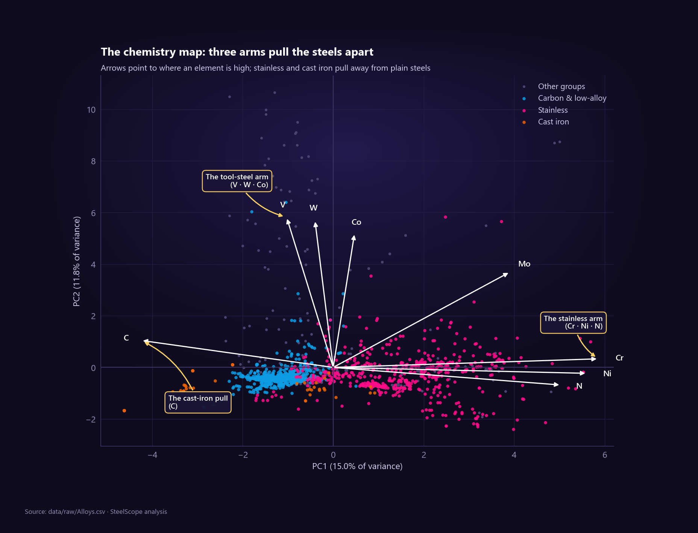</a>

*The chemistry map: twenty elements compressed into two dimensions. Stainless, tool steels and cast irons pull
away from the plain steels in the centre.*

</div>

---

## TL;DR

- We received **2,672 rows** of steel data. They turned out to be **1,389 real steels**: most grades were listed
  twice, and **469 strength values were fake** (exactly the column average, copied in to fill gaps).
- After cleaning it honestly, we tell the data's story in **39 charts** across three Python notebooks, covering
  every technique the course asks for: five-number summaries, binning, chi-square, regression, PCA, chord, ring,
  treemap, radar and waterfall charts.
- The headline findings: **family decides the strength range**, **carbon is the plain steel's strength dial**
  (+43 MPa per 0.1 %), and **more expensive alloy does not mean more strength**.
- A **web app** ([`app/`](app/README.md)) lets anyone explore the grades, inspect one, find substitutes and search
  for a grade that meets a requirement, in the browser.
- Next: interactive **Tableau** dashboards, a **KNIME** workflow that holds all the machine learning, and a **DOCX** report.

---

## The story in six pictures

<table>
<tr>
<td width="33%" valign="top"><a href="reports/figures/03_01_waterfall_cleaning.png">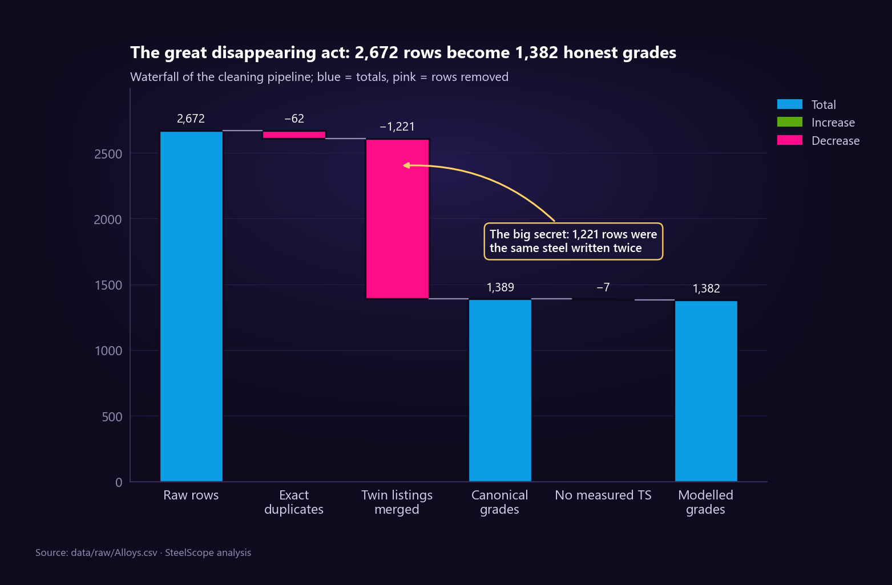</a><br><b>1 · The secret.</b> 2,672 rows shrink to 1,382 honest measurements; the twin listings are the big drop.</td>
<td width="33%" valign="top"><a href="reports/figures/03_04_treemap_families.png">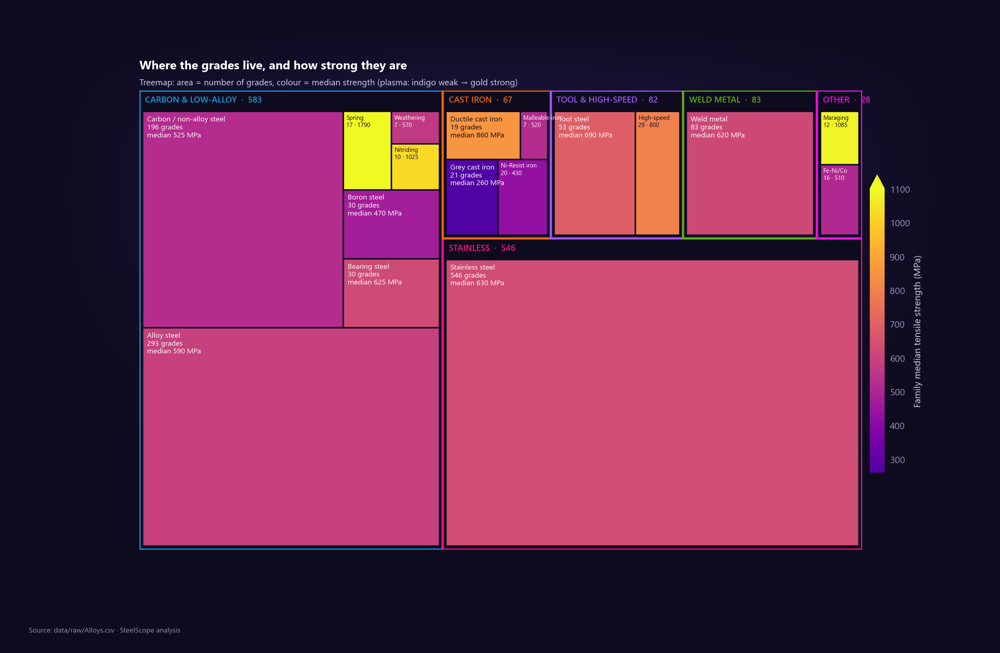</a><br><b>2 · The cast.</b> Stainless and plain steels dominate; the small tiles (spring, maraging) are the strongest.</td>
<td width="33%" valign="top"><a href="reports/figures/03_07_ridgeline_families.png">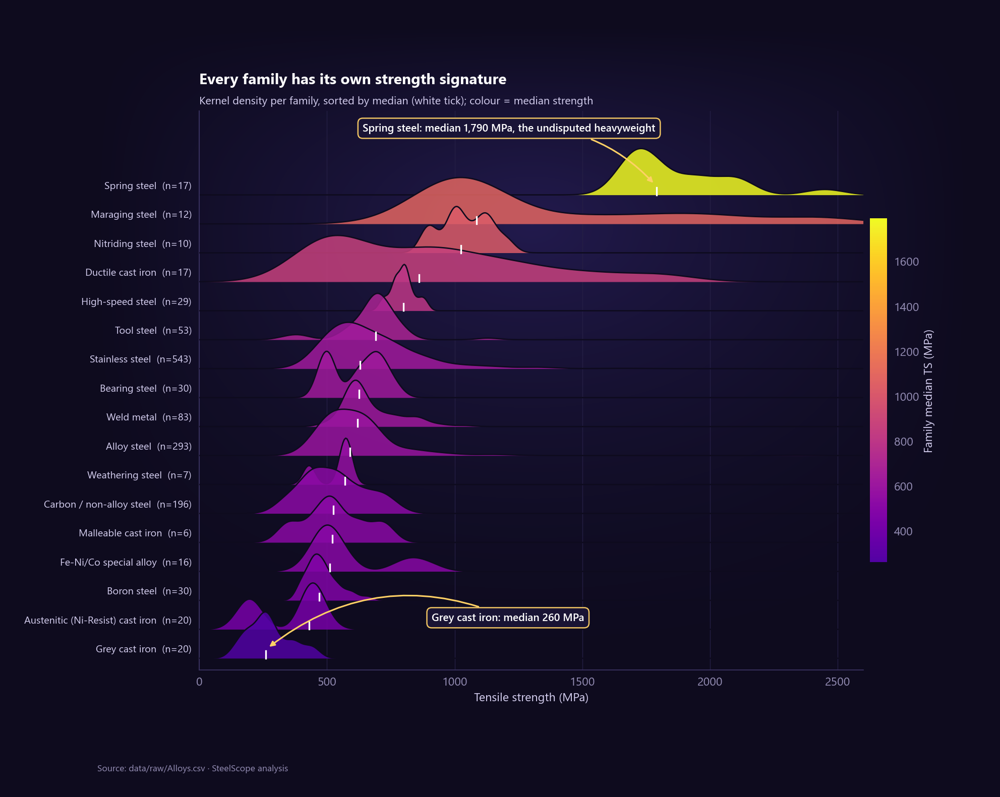</a><br><b>3 · The signatures.</b> Every family has its own strength range, from grey cast iron (260 MPa) to spring steel (1,790 MPa).</td>
</tr>
<tr>
<td valign="top"><a href="reports/figures/03_13_chi_square_residuals.png">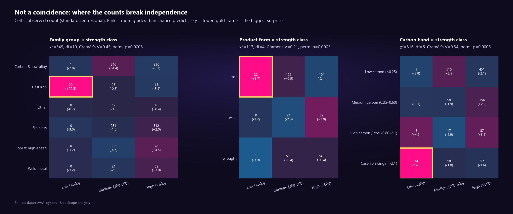</a><br><b>4 · The evidence.</b> Chi-square tests prove the patterns are real: family × strength class χ² = 548.7, Cramér's V = 0.45.</td>
<td valign="top"><a href="reports/figures/02_carbon_simpsons_paradox.png">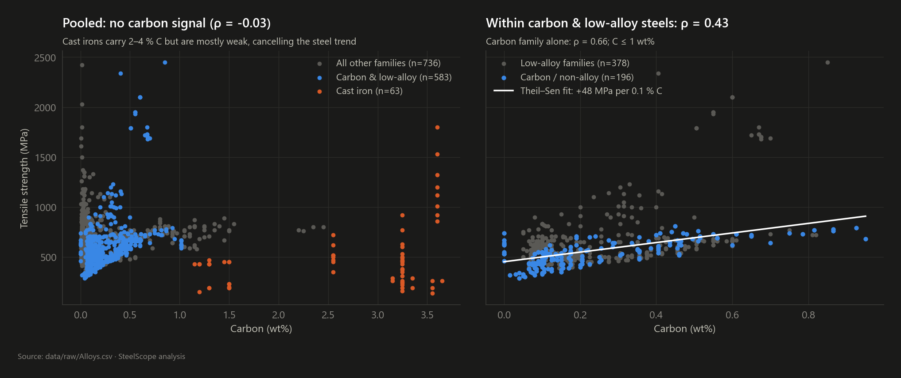</a><br><b>5 · The plot twist.</b> Pooled, carbon looks useless (ρ = −0.03); inside plain steels it is the main strength dial (ρ = 0.43).</td>
<td valign="top"><a href="reports/figures/03_25_radar_overlay_stainless.png">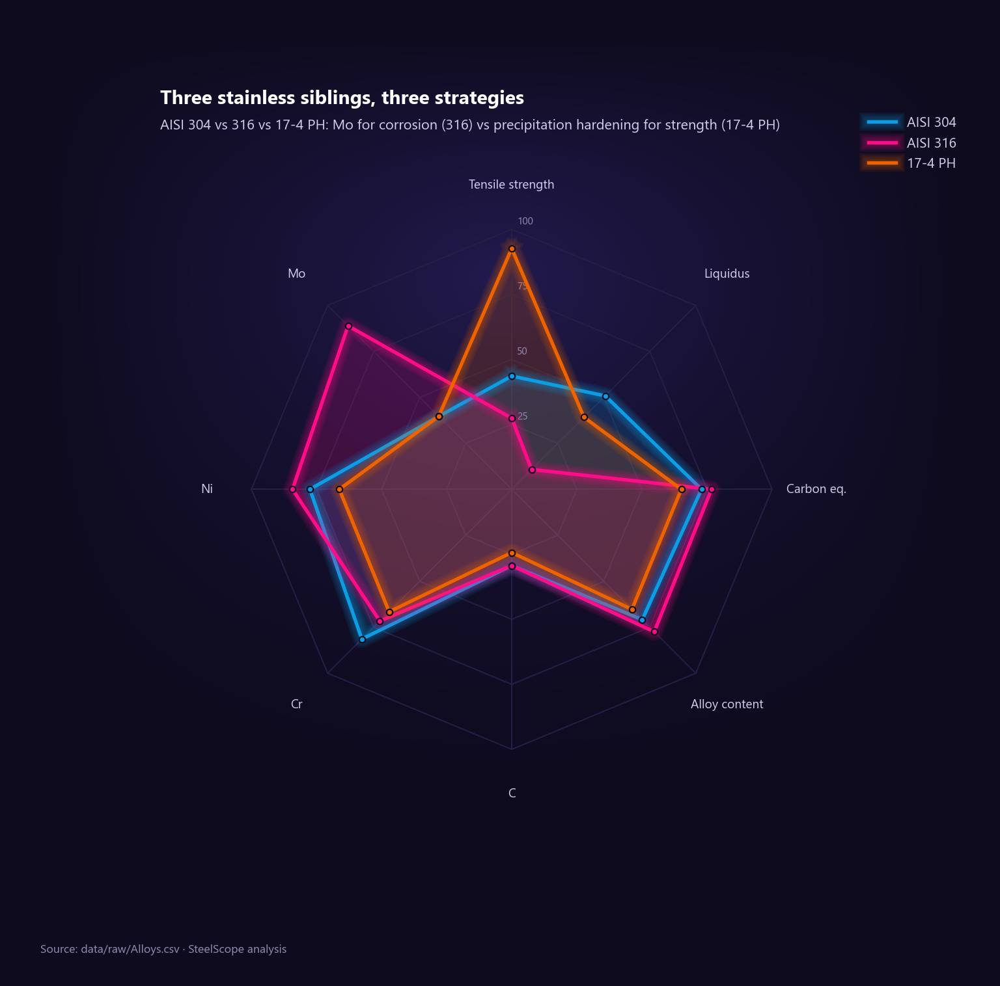</a><br><b>6 · The lesson.</b> 17-4 PH beats nickel-rich 304 and 316 on strength with less nickel: strength is not bought by the kilo.</td>
</tr>
</table>

---

## The web app: SteelScope in the browser

The notebooks tell the story once; the app lets anyone ask their own question of the same data. Built with Next.js
and shadcn/ui, light and dark mode, no installation needed to use it once deployed.

<table>
<tr>
<td width="50%" valign="top"><a href="app/docs/screenshots/explorer.png">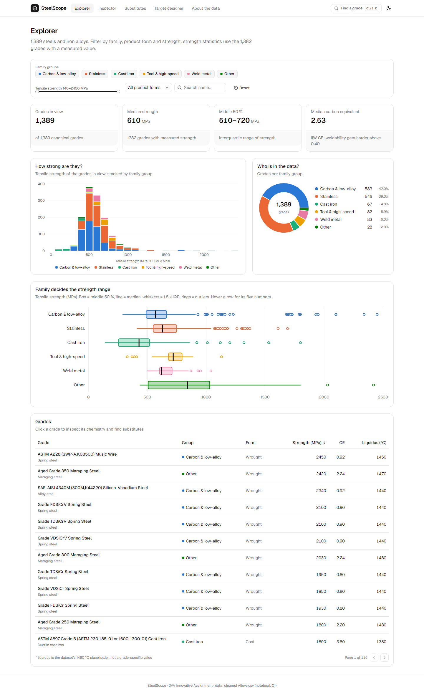</a><br><b>Explorer.</b> Filter 1,389 grades by family, form and strength; the stat cards, histogram, donut, box plots and table recompute live.</td>
<td width="50%" valign="top"><a href="app/docs/screenshots/inspector.png">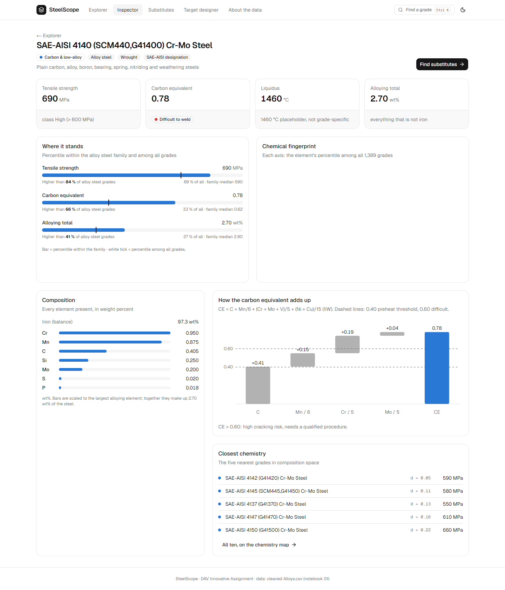</a><br><b>Grade inspector.</b> Any grade in context: percentile within its family, chemistry radar, composition, carbon-equivalent waterfall with the weldability verdict.</td>
</tr>
<tr>
<td valign="top"><a href="app/docs/screenshots/substitutes.png">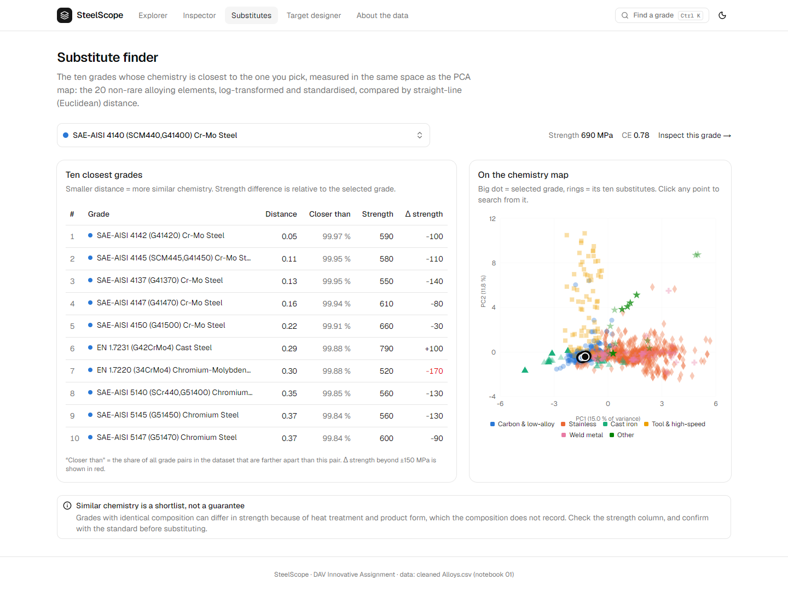</a><br><b>Substitute finder.</b> The ten grades with the closest chemistry, their strength difference, and where they sit on the PCA map.</td>
<td valign="top"><a href="app/docs/screenshots/designer.png">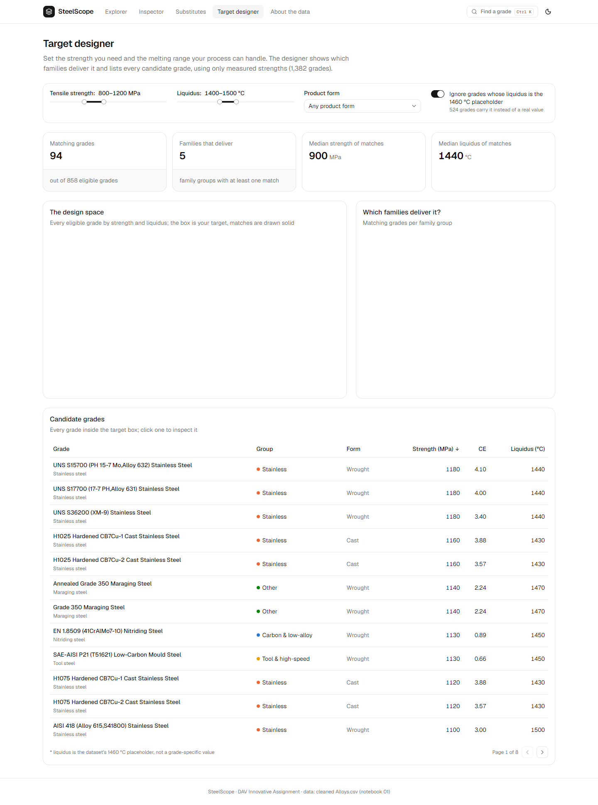</a><br><b>Target designer.</b> Enter a strength and melting window; see which families deliver it and every candidate grade.</td>
</tr>
</table>

**Why it is useful:** it turns the three project questions (drivers, substitution, target design) into tools an
engineer or buyer can use directly, without Python, Tableau or KNIME. What each page does, how to run it and how to
deploy it on Vercel: [app/README.md](app/README.md).

---

## Contents

| | | |
|---|---|---|
| 1. [Goal](#1-goal) | 6. [Key findings](#6-key-findings) | 11. [Glossary](#11-glossary) |
| 2. [Workflow](#2-workflow) | 7. [Figure gallery (all 39)](#7-figure-gallery) | 12. [Working on this repo](#12-working-on-this-repo) |
| 3. [Folder structure and why](#3-folder-structure-and-why) | 8. [Technique coverage](#8-technique-coverage) | 13. [Run it yourself](#13-run-it-yourself) |
| 4. [The data](#4-the-data) | 9. [Faculty demo script](#9-faculty-demo-script) | 14. [Roadmap and future work](#14-roadmap-and-future-work) |
| 5. [How we got here](#5-how-we-got-here) | 10. [FAQ](#10-faq) | |

---

## 1. Goal

**Course goal.** A visualization-intensive data analysis carried across three tools: Python notebooks, Tableau
dashboards and a KNIME workflow, ending in a written report.

**Domain goal.** Engineers and buyers pick steel grades from thousands of standard names (EN, SAE-AISI, ASTM, UNS,
AWS, ACI). We answer the three questions they keep asking:

| # | Question | Where we answer it |
|---|---|---|
| 1 | **Drivers:** which elements make a steel strong, and what controls its melting point? | Notebook 02 (Q2–Q4), notebook 03 (Acts IV–V) |
| 2 | **Substitution:** which grades have a similar chemistry, so one can replace another? | PCA map (notebook 03, Act V); k-NN in KNIME |
| 3 | **Target design:** for a required strength and melting range, which families deliver it? | Notebook 02 (Q5, design space and target query) |

**Who does what.**

| Tool | Role | Status |
|---|---|---|
| **Python notebooks** | Cleaning, statistics and every first-part visualization | Done |
| **Tableau** | Interactive dashboards and a Story, built from `tableau/data/` ([`tableau/`](tableau/README.md)) | Workbooks in `tableau/workbooks/` |
| **KNIME** | The statistics as a node workflow, plus **all machine learning** (k-means, decision tree, k-NN, random forest) ([`knime/`](knime/README.md)) | Workflow in `knime/workflow/` |
| **Power BI** | Six-page interactive report: overview, families and classes, carbon, chemistry map, grade drillthrough, target finder ([`powerbi/`](powerbi/README.md)) | Data, model, measures, theme and guide ready |
| **Web app** | Explorer, grade inspector, substitute finder and target designer on the cleaned data ([`app/`](app/README.md)) | Done |
| **DOCX report** | Final write-up of all parts | To do |

> There is deliberately **no machine learning in Python or in the app**. The ML part belongs in KNIME; the app
> explores, compares and filters, it does not predict.

---

## 2. Workflow

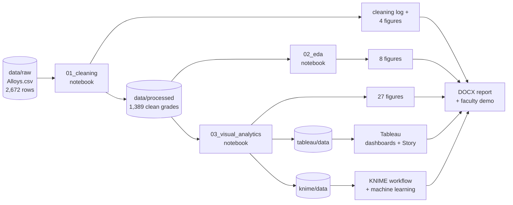

| Step | What happens | Output |
|---|---|---|
| **1 · Clean** | Read the raw file, drop duplicates, merge twin listings, flag fake and placeholder values, rebuild the strength class, add engineered features | `data/processed/`, `reports/cleaning_log.md`, 4 figures |
| **2 · Explore** | Seven questions an engineer would ask, one statistic and one chart each | 8 figures |
| **3 · Tell the story** | A prologue, seven acts and an epilogue covering every required technique | 27 figures, `tableau/data/`, `knime/data/` |
| **4 · Build in Tableau / KNIME** | Follow the guides in `tableau/` and `knime/` | `tableau/workbooks/`, `knime/workflow/`, ML results |
| **5 · Report and present** | Combine everything into the DOCX report | Report + demo |

**The one rule:** data flows one way (`raw → processed → figures / exports → Tableau / KNIME / report`). Nothing
downstream is edited by hand. If something is wrong, fix the notebook and rerun it.

---

## 3. Folder structure and why

```
Project/
├── data/
│   ├── raw/                     ← the original dataset, never edited
│   └── processed/               ← clean tables written by notebook 01
├── notebooks/                   ← the three analysis notebooks (the heart of the project)
├── reports/
│   ├── figures/                 ← all 39 charts as PNG
│   └── cleaning_log.md / .json  ← rows before/after every cleaning step
├── tableau/                     ← everything Tableau: guide, workbooks and their data
│   ├── TABLEAU_GUIDE.md
│   ├── workbooks/               ← DAV_D1.twb, DAV_D2.twb, DAV_D3.twb
│   └── data/                    ← CSVs shaped for Tableau (+ viz/ with ready-made chart shapes)
├── knime/                       ← everything KNIME: guides, workflow, data and Python View scripts
│   ├── KNIME_GUIDE.md, KNIME_WORKFLOW_STEP_BY_STEP.md
│   ├── workflow/                ← SteelScope_Visual_Analytics.knwf
│   ├── data/                    ← knime_input.csv, viz_expected_values.csv
│   └── python_views/            ← copy-paste scripts for Python View nodes
├── powerbi/                     ← everything Power BI: guide, star-schema data, Power Query, DAX measures, theme
├── docs/                        ← guide index, project journey, reusable prompt
├── app/                         ← the web application (Next.js + shadcn/ui), see app/README.md
├── requirements.txt             ← Python packages for the notebooks
└── README.md                    ← you are here
```

<details open>
<summary><b>📁 <code>data/raw/</code>: the untouched source</b></summary>

| File | What it is |
|---|---|
| `Alloys.csv` | The dataset exactly as received: 2,672 rows × 34 columns |

**Why keep it separate and read-only?** The raw file has problems (duplicates, fake values, placeholders). If we
"fixed" it in place, nobody could check what we changed or reproduce our numbers. Keeping it untouched means anyone
can rerun notebook 01 and get exactly our clean data, and every cleaning decision stays traceable.
</details>

<details open>
<summary><b>📁 <code>data/processed/</code>: the single source of truth</b></summary>

| File | What it is | Used by |
|---|---|---|
| `steels_clean.csv` | **The analysis table:** one row per steel grade (1,389 × 59), duplicates merged, fake values removed, features added | Notebooks 02 and 03, all exports |
| `steels_listings.csv` | The 2,610 de-duplicated raw rows, each linked to its grade | Notebook 02 (with vs without fake values), the chord chart |
| `DATA_DICTIONARY.md` | Every column: unit, type, range and meaning, generated from the data | Anyone asking "what does this column mean?" |
| `pipeline_meta.json` | Small facts later notebooks need (e.g. the 10 rare elements) | Notebook 03 |

**Why a separate processed folder?** The raw file has 2,672 rows but only 1,389 real steels. Analysing it directly
would count most steels twice and include 469 fake strengths. Every chart, export and tool reads this one cleaned
table, so all numbers agree everywhere.
</details>

<details open>
<summary><b>📓 <code>notebooks/</code>: where the analysis happens</b></summary>

| Notebook | What it does | Writes |
|---|---|---|
| [`01_cleaning.ipynb`](notebooks/01_cleaning.ipynb) | Builds the cleaning pipeline step by step and shows the evidence for each decision | `data/processed/`, `reports/cleaning_log.*`, `01_*` figures (4) |
| [`02_eda.ipynb`](notebooks/02_eda.ipynb) | Seven engineering questions, one statistic and one chart each | `02_*` figures (8) |
| [`03_visual_analytics.ipynb`](notebooks/03_visual_analytics.ipynb) | "The Secret Lives of 1,389 Steels": the full visual story, then the Tableau/KNIME exports | `03_*` figures (27), `tableau/data/`, `knime/data/` |

**Self-contained by design:** the code for every step sits in the cell right above its output, so you never open
another file to see how a number or chart was made. Functions named `plot_…` draw charts; every other function
computes numbers. The first two cells (setup + "Neon Forge" chart theme) are identical in all three notebooks.
</details>

<details open>
<summary><b>🖼️ <code>reports/</code>: finished results for slides and the report</b></summary>

| Item | What it is |
|---|---|
| `figures/` | All 39 charts. The prefix names the notebook: `01_*`, `02_*`, `03_NN_*` (03 is numbered in story order) |
| `cleaning_log.md` | Every cleaning step with rows before and after, and the details behind each number |
| `cleaning_log.json` | The same log, machine-readable |

**Why?** These go straight into the DOCX report and the demo. They are regenerated on every notebook run, so they
always match the code.
</details>

<details open>
<summary><b>🔌 <code>tableau/</code> and <code>knime/</code>: everything for the two tools</b></summary>

| File | Rows | Used for |
|---|---|---|
| [`tableau/TABLEAU_GUIDE.md`](tableau/TABLEAU_GUIDE.md) | – | Build 18 sheets, 3 dashboards and a Story, step by step |
| `tableau/workbooks/DAV_D1–D3.twb` | – | The team's Tableau workbooks (see [tableau/README.md](tableau/README.md)) |
| `tableau/data/steels_wide.csv` | 1,389 | One row per grade with every column: most Tableau sheets |
| `tableau/data/steels_long.csv` | 41,670 | One row per (grade, element): composition charts and heatmaps |
| `tableau/data/family_summary.csv` | 17 | Medians and percentiles per family |
| `tableau/data/viz/*.csv` (17 files) | various | Statistics tables (five-number summary, chi-square cells, regression bands, PCA) and **ready-made x/y shapes** for chord, radar, radial-bar and waterfall charts |
| [`knime/KNIME_GUIDE.md`](knime/KNIME_GUIDE.md), [`KNIME_WORKFLOW_STEP_BY_STEP.md`](knime/KNIME_WORKFLOW_STEP_BY_STEP.md) | – | Node settings with expected values, and the click-by-click build sheet |
| `knime/workflow/SteelScope_Visual_Analytics.knwf` | – | The finished KNIME workflow (see [knime/README.md](knime/README.md)) |
| `knime/data/knime_input.csv` | 1,389 | Main KNIME input with a train/test `split` column (identical chemistries never land on both sides) |
| `knime/data/viz_expected_values.csv` | 85 | Every statistic KNIME should reproduce, to check the workflow against Python |
| `knime/python_views/*.py` | – | Copy-paste scripts for KNIME *Python View* nodes (radar, chord, waterfall, circular columns, treemap, chi-square heatmap) |

**Why not give Tableau the processed CSV directly?** Tableau cannot draw chord, radar or waterfall charts natively,
so Python computes the shapes and exports their coordinates; Tableau only connects the dots. KNIME gets a ready,
fair train/test split for its models. The CSVs in `tableau/data/` and `knime/data/` are generated: never edit them
by hand, rerun notebook 03.
</details>

<details open>
<summary><b>📚 <code>docs/</code>: instructions and the decision log</b></summary>

| File | Purpose |
|---|---|
| [`GUIDE.md`](docs/GUIDE.md) | Index of every guide (Tableau and KNIME guides now live in `tableau/` and `knime/`) |
| [`PROJECT_JOURNEY.md`](docs/PROJECT_JOURNEY.md) | The project diary: every decision and the numbers behind it, phase by phase |
| [`CLAUDE_CODE_PROMPT.md`](docs/CLAUDE_CODE_PROMPT.md) | The reusable AI prompt used to plan and build this kind of project for any dataset |
</details>

---

## 4. The data

**Source:** `data/raw/Alloys.csv`. Every row is iron-based (minimum 29.3 % Fe), so the domain is **steels and iron
alloys**: carbon, alloy, stainless, tool, high-speed, maraging, cast iron, weld metal and a few Fe-Ni specials.

| Raw column | Meaning |
|---|---|
| `Alloy` | Grade name, e.g. "AISI 304 (S30400) Stainless Steel" |
| `Tensile Strength` | Ultimate tensile strength in MPa (how hard you can pull before it breaks) |
| `Melting Completion (Liquidus)` | Temperature (°C) at which the steel is fully molten |
| `Class` | Strength class 0 / 1 / 2 (low < 300, medium 300–600, high > 600 MPa) |
| 30 element columns | Al, As, B, C, Ca, Ce, Co, Cr, Cu, Fe, La, Mg, Mn, Mo, N, Nb, Ni, O, P, Pb, S, Se, Si, Sn, Ta, Ti, V, W, Zn, Zr in wt% |

### What was wrong, and what we decided

| # | Problem found | Evidence | Decision |
|---|---|---|---|
| 1 | Exact duplicate rows | 62 rows | Dropped |
| 2 | Fake strength values | 469 rows hold 652.48 MPa, exactly the column average | Flagged; never used as a strength |
| 3 | Same steel listed twice ("EN 1.0420 (GE200)…" and "EN-1.0420-GE200-…") | 1,221 grades listed twice; the twins never disagree | Merged into one row per grade (2,610 → 1,389) |
| 4 | Fake values sit on the duplicate listing | 459 of the 469 have a twin with the real value | Use the twin's real value; only **7 grades** are truly unmeasured |
| 5 | Same chemistry, different strength | 28 composition groups | Kept: heat treatment, which the data does not record |
| 6 | `Class` is just binned strength | Rebuilt class matches the original on 100 % of real rows | Rebuilt from real strength: 23 / 648 / 711 grades |
| 7 | Melting point of exactly 1460 °C | 524 grades (37.7 %), does not react to carbon | Kept but flagged as a family default, not a measurement |
| 8 | Composition sums of 95–105 % | 98.7 % of grades within 99–101 % | Kept: these are specification midpoints |
| 9 | Ten very rare elements | Non-zero in fewer than 30 rows | Summed into `trace_total` |

### Columns we added

| Column | Meaning |
|---|---|
| `family`, `family_label`, `family_group` | 17 families from name rules (with a composition fallback), grouped into 6 family groups |
| `carbon_equivalent` | Weldability index CE = C + Mn/6 + (Cr+Mo+V)/5 + (Ni+Cu)/15 |
| `alloying_total` | 100 − Fe: how much alloy the steel carries |
| `cr_eq`, `ni_eq` | Schaeffler chromium and nickel equivalents (stainless microstructure) |
| `product_form`, `naming_source` | Wrought / cast / weld; which standards body named it |
| `is_imputed_ts`, `liquidus_is_default` | Flags for the fake strength and placeholder melting point |
| `composition_group_id` | Same id for grades with identical chemistry (used for the fair train/test split) |

Every column is documented in [`data/processed/DATA_DICTIONARY.md`](data/processed/DATA_DICTIONARY.md).

---

## 5. How we got here

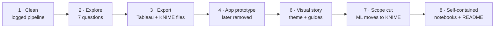

| Phase | What happened | Why |
|---|---|---|
| 1 · Cleaning | Built a logged cleaning pipeline; found the twin listings, the fake 652.48 MPa values and the 1460 °C placeholder | No chart can be trusted until the data is honest |
| 2 · Exploration | Seven question-driven analyses, plus a first round of Python models (later removed) | Find the real patterns before designing the story |
| 3 · Exports | First hand-off files for Tableau and KNIME | The project spans three tools |
| 4 · App prototype | A small web app to browse grades (later removed) | Explored what else the data could do |
| 6 · Visual story | Notebook 03 with every required technique, the colour-blind-safe "Neon Forge" theme, a narrative in acts, the Tableau and KNIME guides | The course is visualization-first |
| 7 · Scope cut | Removed the web app and all Python ML; ML moved to KNIME; notebooks renumbered 01-02-03 | Keep the project on the brief |
| 8 · Self-contained | All code moved into the notebooks, helper folders removed, this README | Teammates can read and present the work without hunting through files |

After every restructuring step, all regenerated files were compared with the previous version: the numbers never
changed. Full diary: [docs/PROJECT_JOURNEY.md](docs/PROJECT_JOURNEY.md).

---

## 6. Key findings

> **1 · Clean before you count.** 2,672 rows were really 1,389 steels. 1,221 grades were listed twice, and the 469
> fake strengths (652.48 MPa, the column average) hid in those duplicates. Only 7 grades truly lack a measurement.

> **2 · Think in medians.** Strength is right-skewed: median 610 MPa, mean 651.6 MPa, 75 outliers above the upper
> whisker. Keeping the fake values would have inflated the high-strength share from 51 % to 61 %.

> **3 · Family first, chemistry second.** Family alone explains about 30 % of the strength ranking (Kruskal–Wallis
> ε² = 0.30). Family medians run from 260 MPa (grey cast iron) to 1,790 MPa (spring steel).

> **4 · Carbon is the plain steel's dial, but only inside plain steels.** Pooled, ρ = −0.03 (Simpson's paradox: cast
> irons hold 3.25 % carbon yet are weak). In carbon steels, each +0.1 % C adds about +43 MPa (OLS, R² = 0.51).

> **5 · More alloy is not more strength.** Inside stainless, alloy content is unrelated to strength (ρ = −0.07).
> Precipitation-hardening grades (median 850 MPa) beat nickel-rich austenitic grades (590 MPa).

> **6 · The patterns are real.** All five chi-square tests reject independence (permutation p ≈ 0.0005). The
> strongest link, family ↔ 1460 °C liquidus (Cramér's V = 0.67), proves that value is a family habit, not a measurement.

> **7 · Processing writes the last chapter.** 28 groups share an identical chemistry but differ in strength (heat
> treatment). Any composition-only model will be off by about 111 MPa on those grades.

---

## 7. Figure gallery

All 39 charts live in [`reports/figures/`](reports/figures/). Click any thumbnail for the full-size image. Captions
state each chart's message, so they can be presented as written.

### 7.1 · Notebook 01: cleaning the data

<table>
<tr>
<td width="50%" valign="top"><a href="reports/figures/01_cleaning_funnel.png">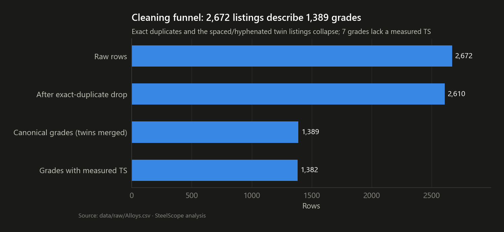</a><br><b>Cleaning funnel.</b> 2,672 raw rows → 2,610 without exact duplicates → 1,389 grades after merging twins → 1,382 with a measured strength.</td>
<td width="50%" valign="top"><a href="reports/figures/01_twin_listings_imputation.png">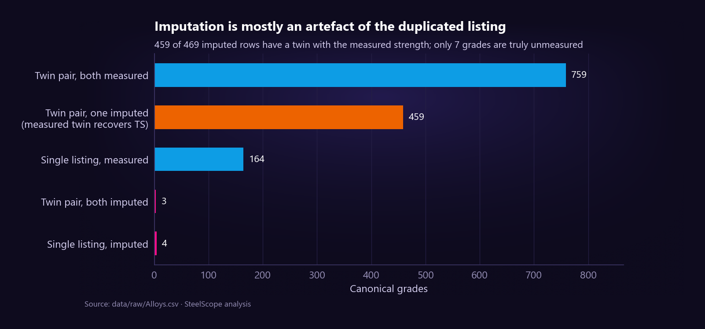</a><br><b>Fake values hide in the duplicates.</b> 459 of the 469 fake strengths have a twin listing that holds the real value; only 7 grades are truly unmeasured.</td>
</tr>
<tr>
<td valign="top"><a href="reports/figures/01_processing_variants.png">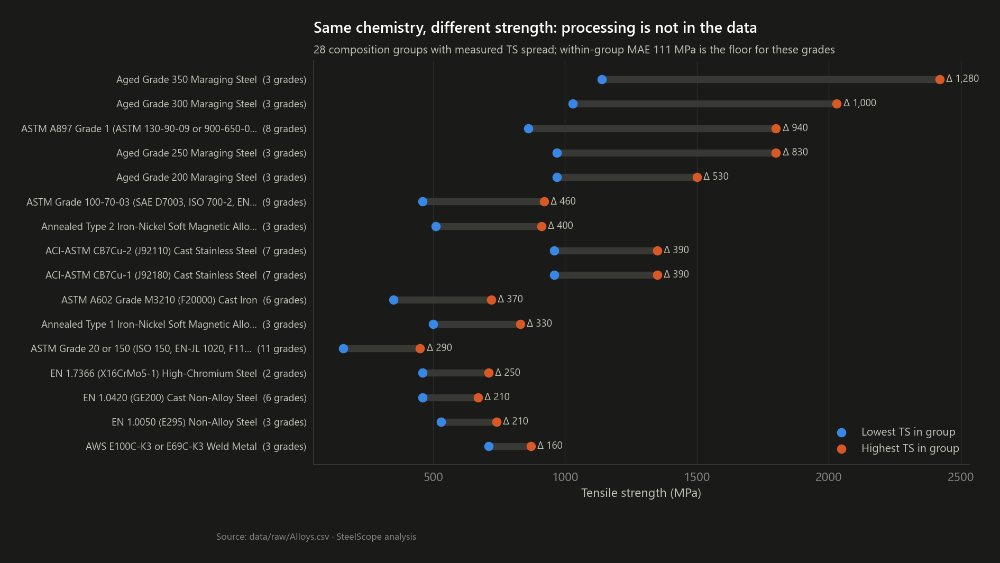</a><br><b>Same chemistry, different strength.</b> 28 composition groups (maraging aged vs annealed, stainless tempers, cast irons) differ only by heat treatment: the floor for any composition-only model.</td>
<td valign="top"><a href="reports/figures/01_liquidus_default.png">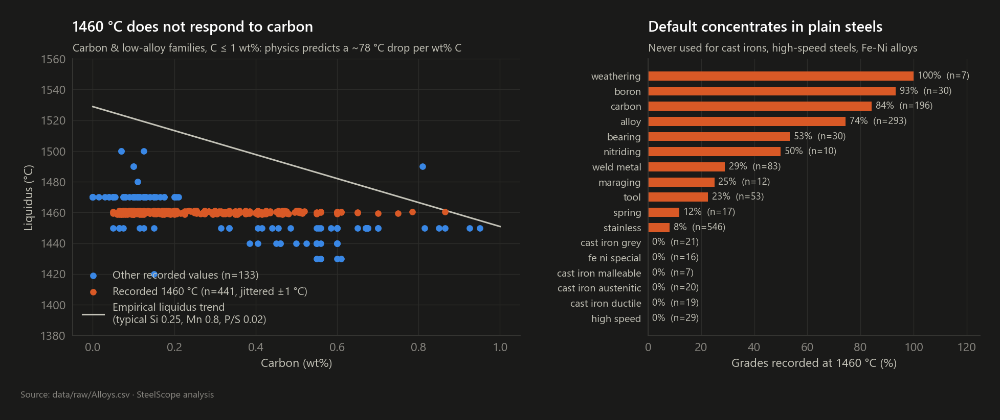</a><br><b>1460 °C is a placeholder.</b> 524 grades share it; it ignores carbon (physics says it should drop) and never appears for cast irons, high-speed steels or Fe-Ni alloys.</td>
</tr>
</table>

### 7.2 · Notebook 02: seven engineering questions

<table>
<tr>
<td width="50%" valign="top"><a href="reports/figures/02_strength_by_family.png">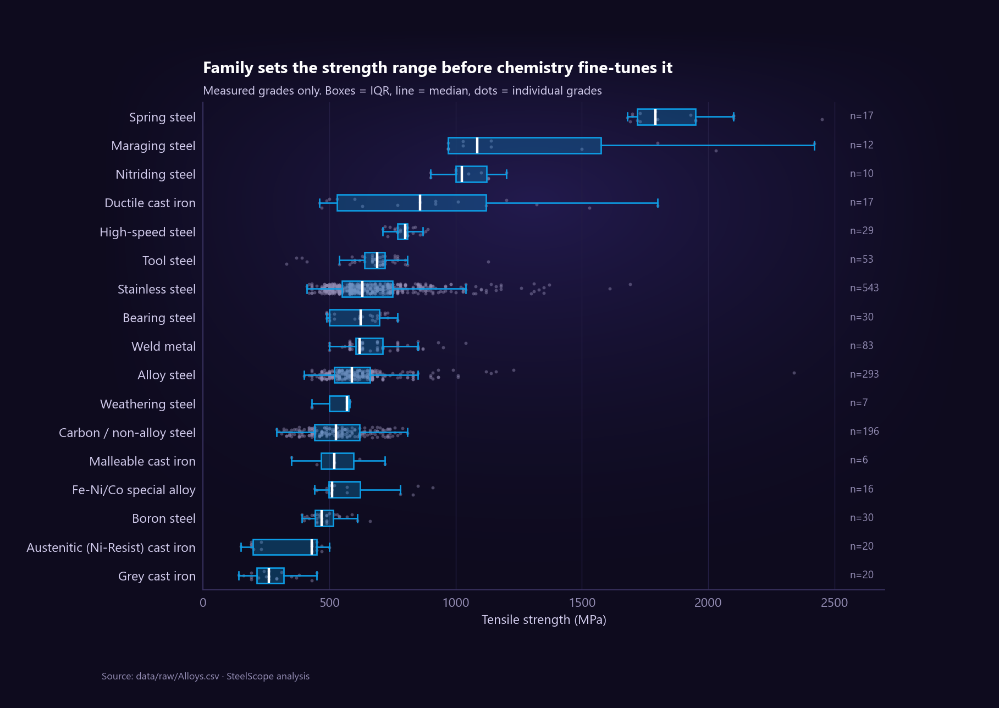</a><br><b>Q1 · Family sets the range.</b> Box plots per family sorted by median; family alone explains about 30 % of the strength ranking.</td>
<td width="50%" valign="top"><a href="reports/figures/02_carbon_simpsons_paradox.png"></a><br><b>Q2 · Simpson's paradox.</b> Pooled ρ = −0.03; within carbon & low-alloy steels ρ = 0.43 (carbon family 0.66), about +48 MPa per 0.1 % C (Theil–Sen).</td>
</tr>
<tr>
<td valign="top"><a href="reports/figures/02_element_correlations.png">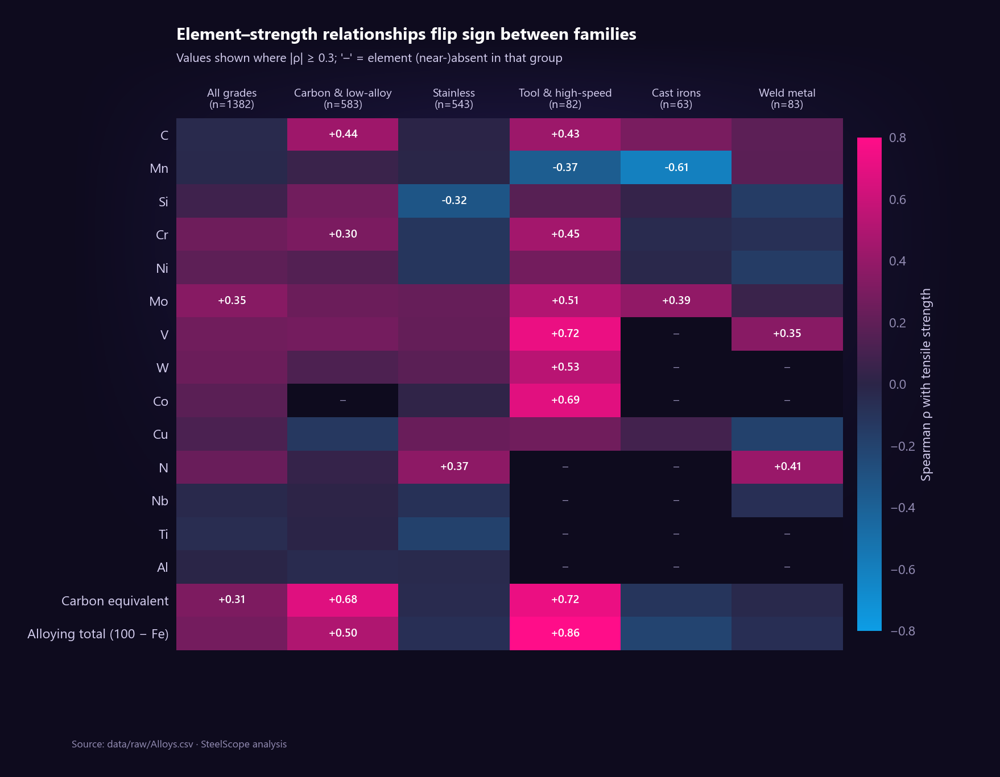</a><br><b>Q2 · Effects flip between families.</b> Si helps plain steels (+0.26) but not stainless (−0.32); V (+0.72) and Co (+0.69) dominate tool steels; N helps stainless (+0.37).</td>
<td valign="top"><a href="reports/figures/02_cr_ni_map.png">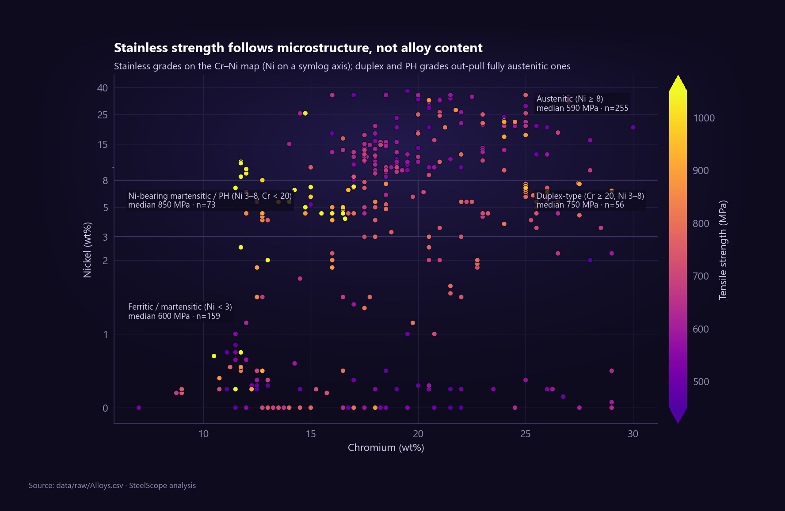</a><br><b>Q3 · Microstructure, not alloy content.</b> PH grades (850 MPa) and duplex (750) out-pull fully austenitic grades (590) that carry the most nickel.</td>
</tr>
<tr>
<td valign="top"><a href="reports/figures/02_ce_vs_strength.png">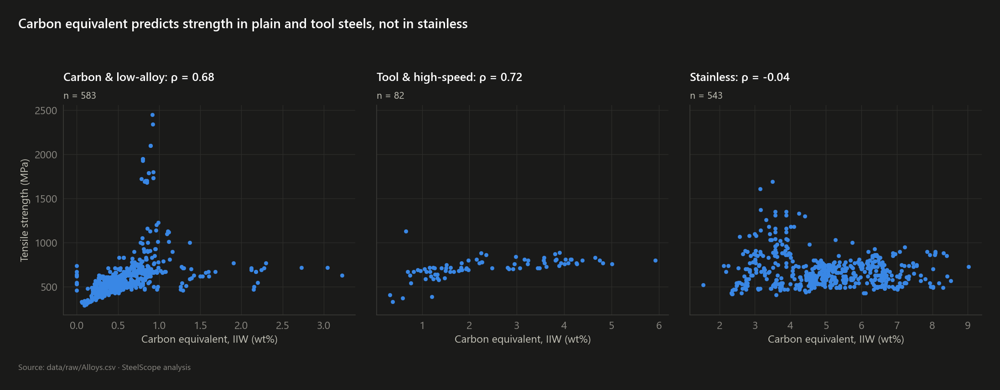</a><br><b>Q4 · Carbon equivalent, used wisely.</b> Tracks strength in plain (ρ = 0.68) and tool steels (0.72), not in stainless (−0.04).</td>
<td valign="top"><a href="reports/figures/02_design_space.png">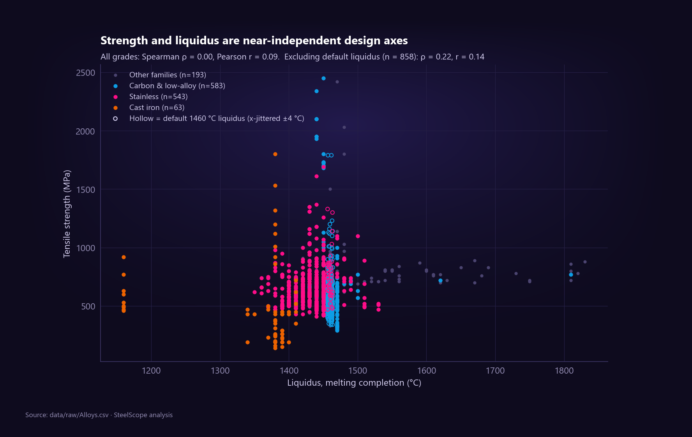</a><br><b>Q5 · Two independent design axes.</b> Strength vs melting point: ρ = 0.00 overall, 0.22 without the placeholder values (n = 858).</td>
</tr>
<tr>
<td valign="top"><a href="reports/figures/02_class_drivers.png">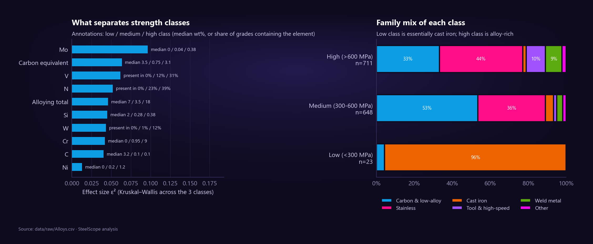</a><br><b>Q6 · What separates the classes.</b> No single element does (largest effect Mo, ε² = 0.10); family does: the low class is almost all cast iron.</td>
<td valign="top"><a href="reports/figures/02_imputation_sensitivity.png">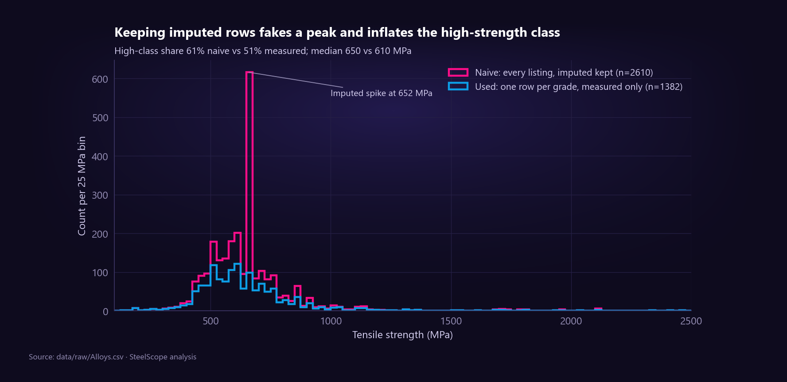</a><br><b>Q7 · Fake values mislead.</b> A false spike at 652 MPa; the high-strength share would read 61 % instead of 51 %, the median 650 instead of 610 MPa.</td>
</tr>
</table>

### 7.3 · Notebook 03: "The Secret Lives of 1,389 Steels"

#### Prologue · The dataset had a secret

<table>
<tr>
<td width="50%" valign="top"><a href="reports/figures/03_01_waterfall_cleaning.png"></a><br><b>03_01 · Waterfall.</b> 2,672 → −62 duplicates → −1,221 twins → 1,389 grades → −7 unmeasured → 1,382.</td>
<td width="50%" valign="top"><a href="reports/figures/03_02_chord_raw_class_migration.png">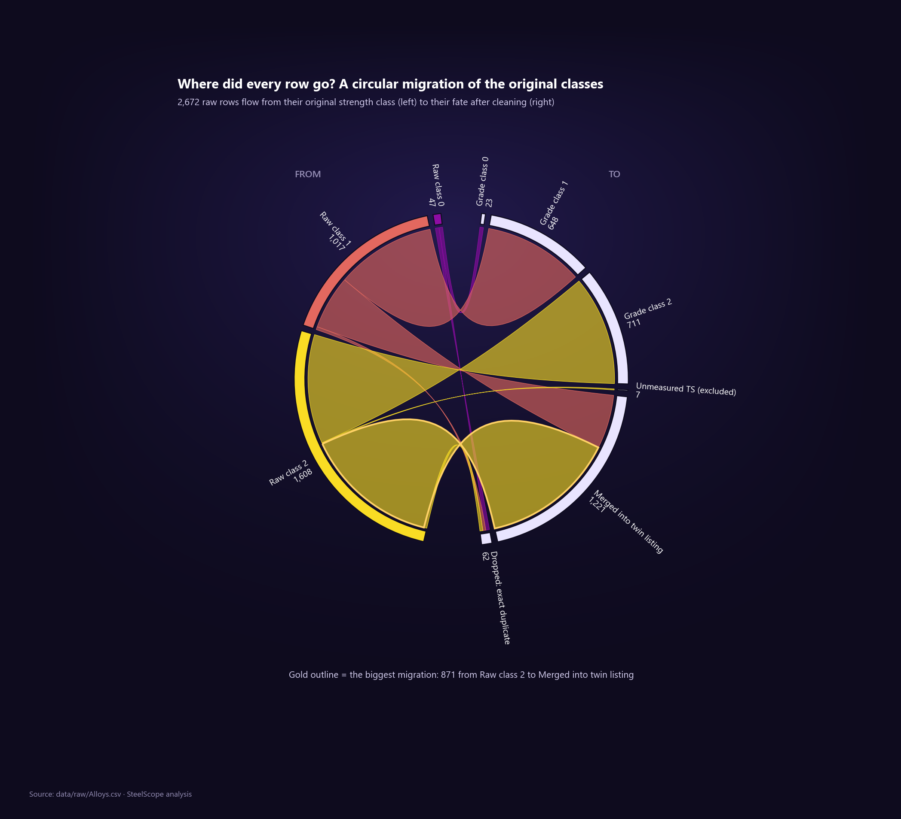</a><br><b>03_02 · Chord (circular migration).</b> Raw class → each row's fate. The biggest ribbon: 871 class-2 rows fold into their twin. No row changes class.</td>
</tr>
</table>

#### Act I · Meet the cast

<table>
<tr>
<td width="50%" valign="top"><a href="reports/figures/03_03_ring_families.png">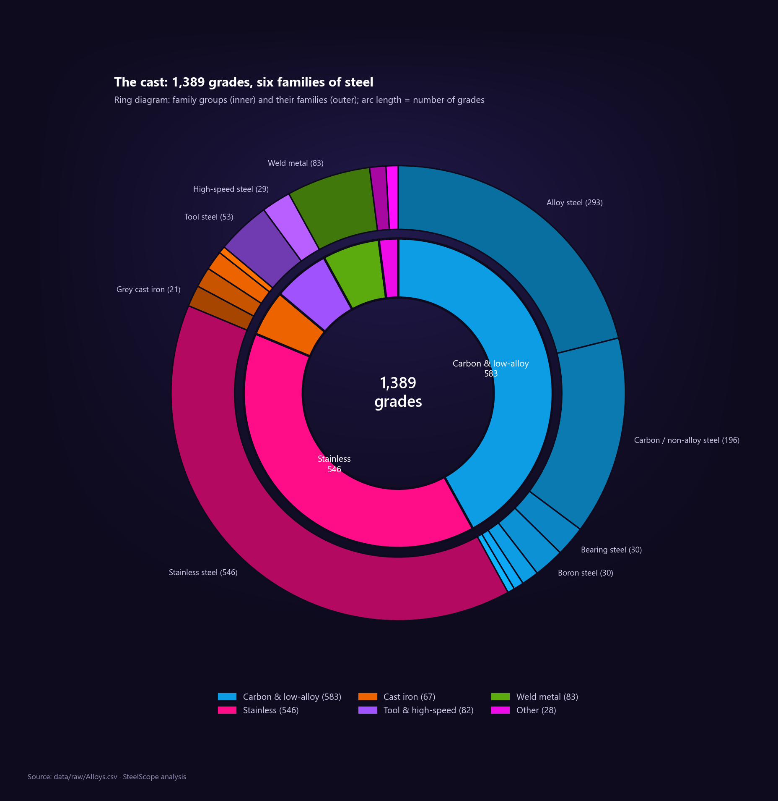</a><br><b>03_03 · Ring diagram.</b> Six family groups (inner) and 17 families (outer). Stainless is about four grades in ten.</td>
<td width="50%" valign="top"><a href="reports/figures/03_04_treemap_families.png"></a><br><b>03_04 · Treemap.</b> Area = grades, colour = median strength. The small tiles (spring, maraging, nitriding) glow brightest.</td>
</tr>
<tr>
<td valign="top"><a href="reports/figures/03_05_five_number_summary.png">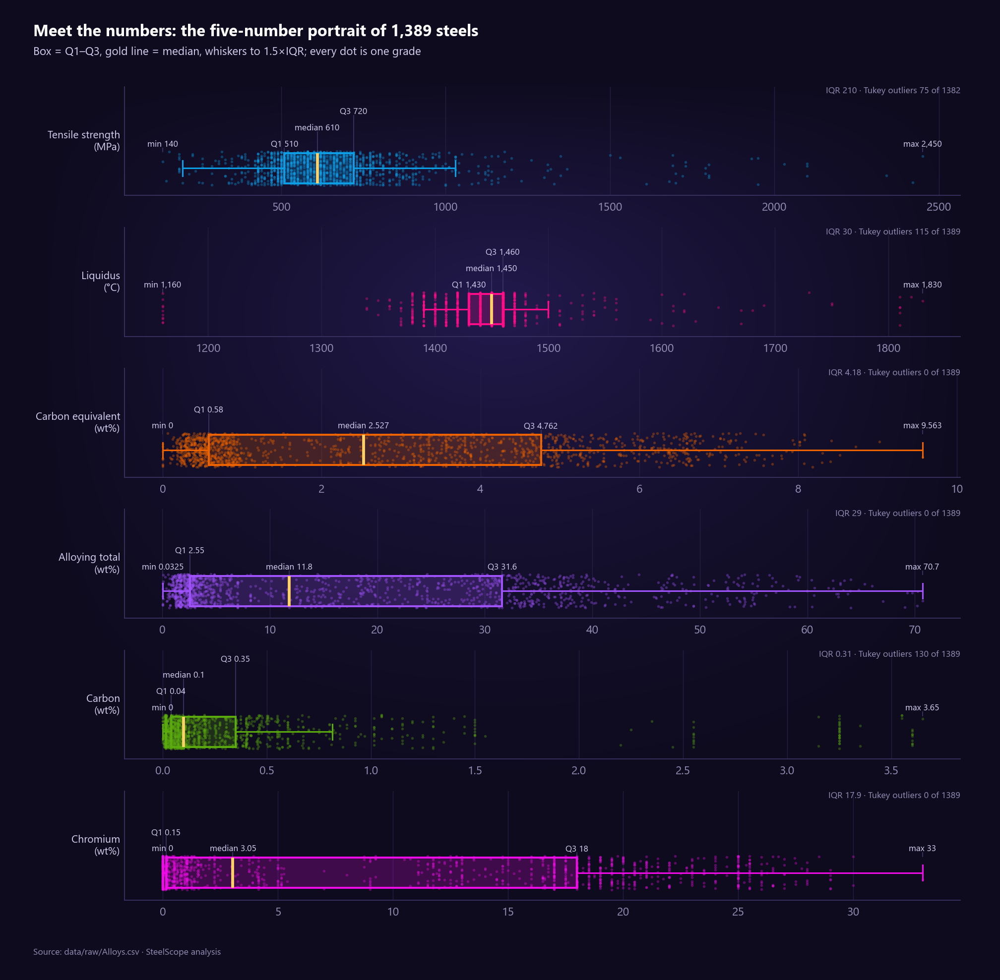</a><br><b>03_05 · Five-number summary.</b> Strength: 140 / 510 / 610 / 720 / 2,450 MPa; IQR 210; 75 Tukey outliers.</td>
<td valign="top"><a href="reports/figures/03_06_distributions.png">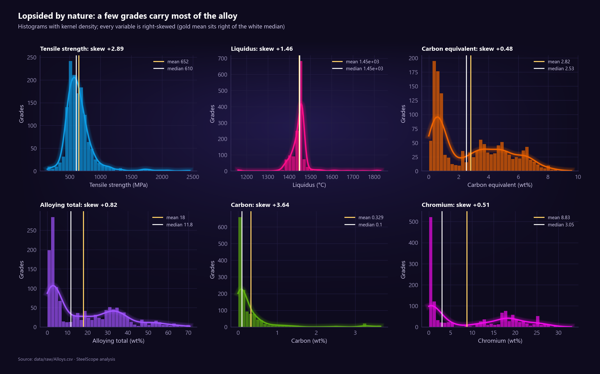</a><br><b>03_06 · Distributions.</b> Every variable is right-skewed (mean right of median), so we report medians.</td>
</tr>
</table>

#### Act II · Every family has a signature

<table>
<tr>
<td width="50%" valign="top"><a href="reports/figures/03_07_ridgeline_families.png"></a><br><b>03_07 · Ridgeline.</b> One strength curve per family; grey cast iron at the bottom, spring steel the heavyweight on top.</td>
<td width="50%" valign="top"><a href="reports/figures/03_08_ecdf_groups.png">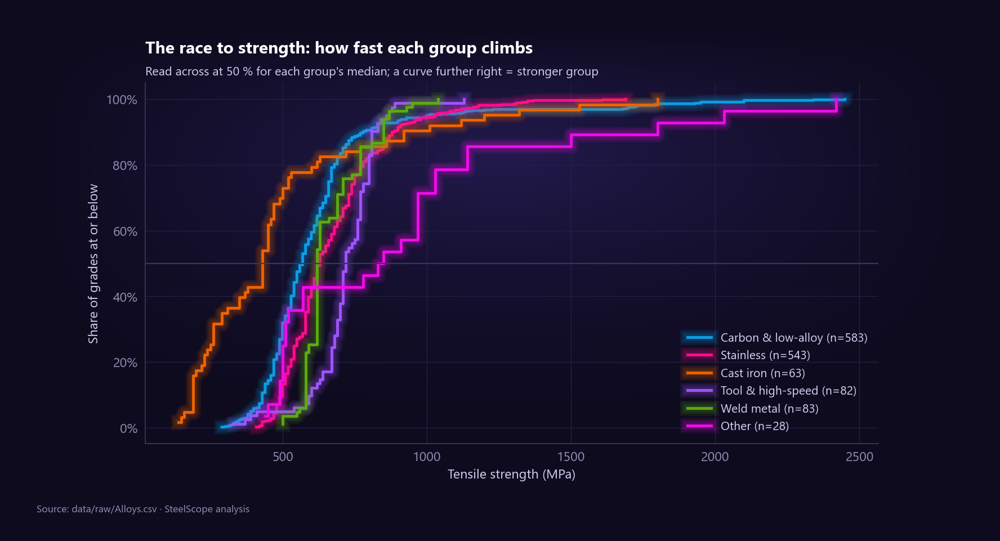</a><br><b>03_08 · ECDF race.</b> The curve that climbs latest is the strongest group; read across at 50 % for each median.</td>
</tr>
<tr>
<td valign="top"><a href="reports/figures/03_09_violin_groups.png">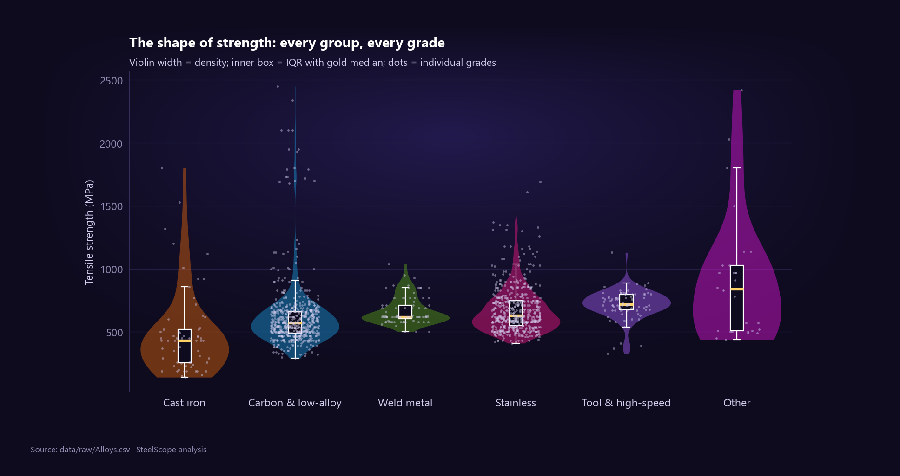</a><br><b>03_09 · Violin + strip + box.</b> The full shape of strength in every group, every grade a dot.</td>
<td valign="top"><a href="reports/figures/03_10_circular_columns_strength.png">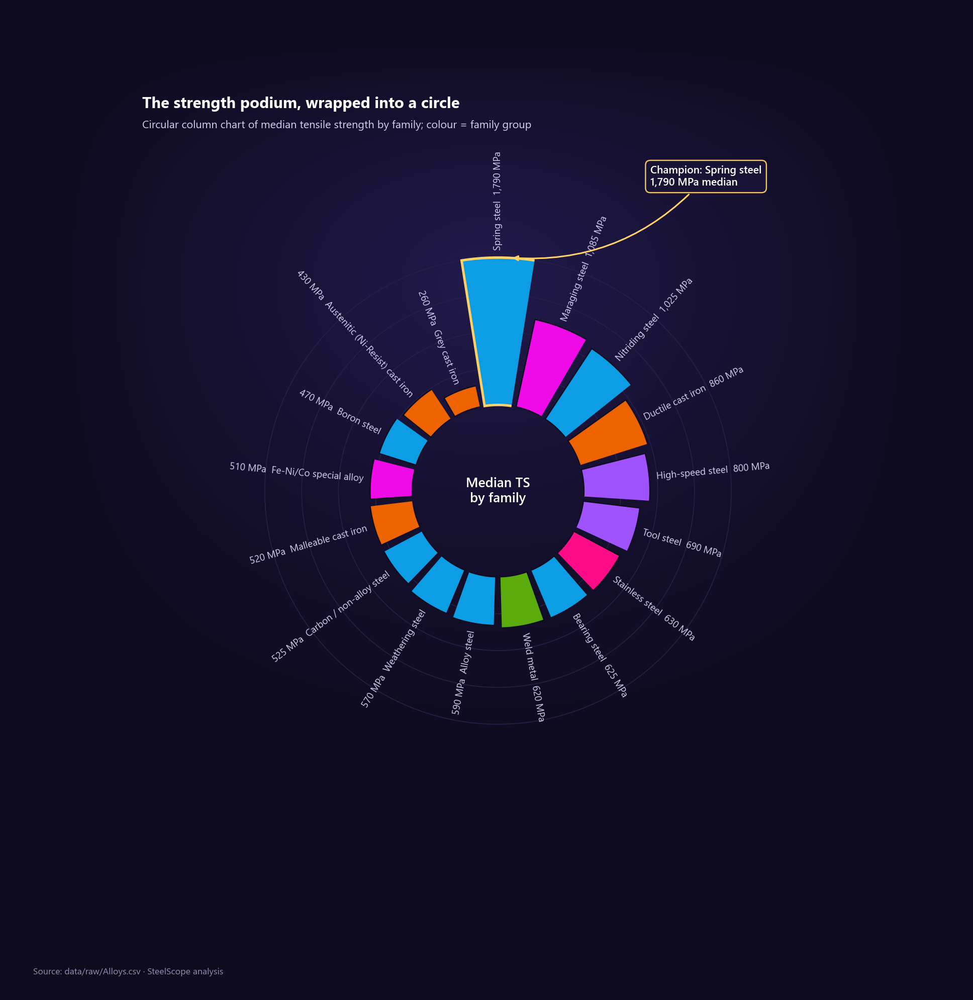</a><br><b>03_10 · Circular columns.</b> Median strength by family: spring 1,790, maraging 1,085, nitriding 1,025 MPa; grey cast iron 260.</td>
</tr>
</table>

#### Act III · Slicing and testing the evidence

<table>
<tr>
<td width="50%" valign="top"><a href="reports/figures/03_11_binning_width_vs_frequency.png">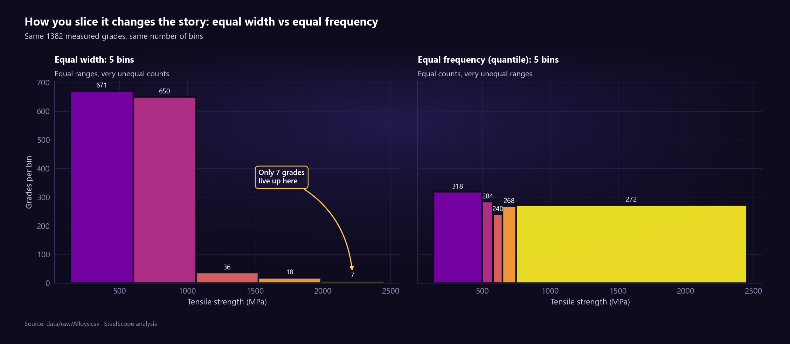</a><br><b>03_11 · Equal width vs equal frequency.</b> Same 5 bins: 671 / 650 / 36 / 18 / 7 grades vs 318 / 284 / 240 / 268 / 272.</td>
<td width="50%" valign="top"><a href="reports/figures/03_12_domain_bins.png">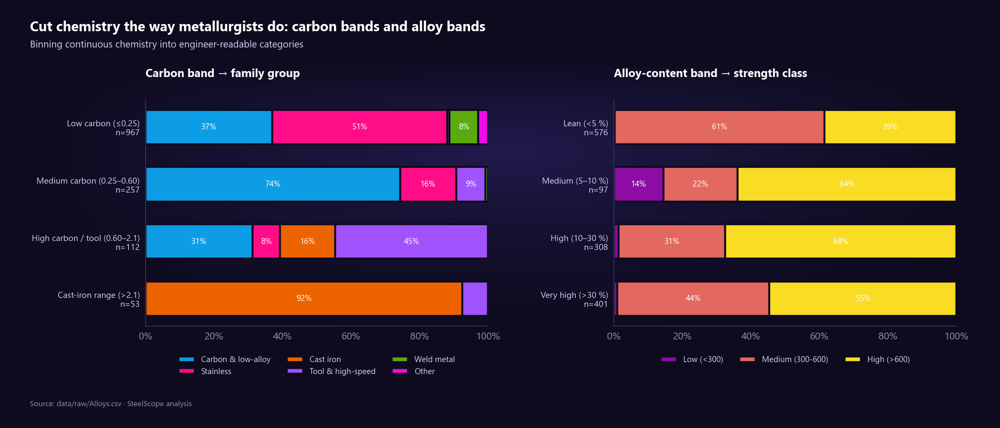</a><br><b>03_12 · Metallurgical bins.</b> The ">2.1 % carbon" band is cast-iron territory; the high-strength share climbs with each alloy band.</td>
</tr>
<tr>
<td valign="top"><a href="reports/figures/03_13_chi_square_residuals.png"></a><br><b>03_13 · Chi-square residuals.</b> Family group × class: χ² = 548.7, df = 10, V = 0.45. Gold frame = biggest surprise (cast irons in the low class).</td>
<td valign="top"><a href="reports/figures/03_14_cramers_v.png">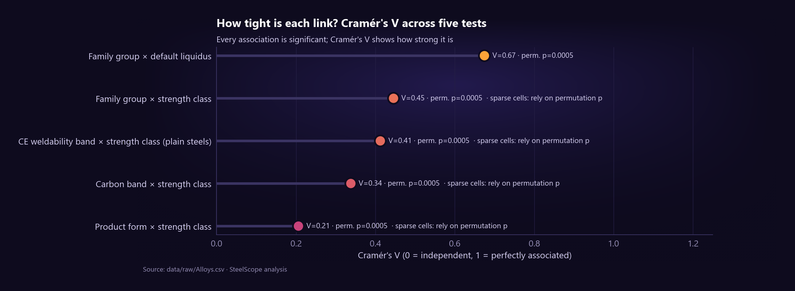</a><br><b>03_14 · Cramér's V.</b> All five links significant; family ↔ default liquidus strongest (V = 0.67). Sparse tables confirmed by permutation test.</td>
</tr>
</table>

#### Act IV · What actually drives strength

<table>
<tr>
<td width="50%" valign="top"><a href="reports/figures/03_15_correlation_clustermap.png">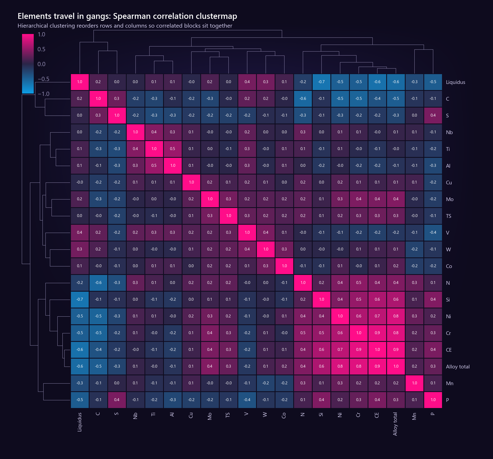</a><br><b>03_15 · Correlation clustermap.</b> Elements travel in gangs: Cr–Ni–N (stainless) and W–V–Mo–Co (tool steels).</td>
<td width="50%" valign="top"><a href="reports/figures/03_16_simple_regression.png">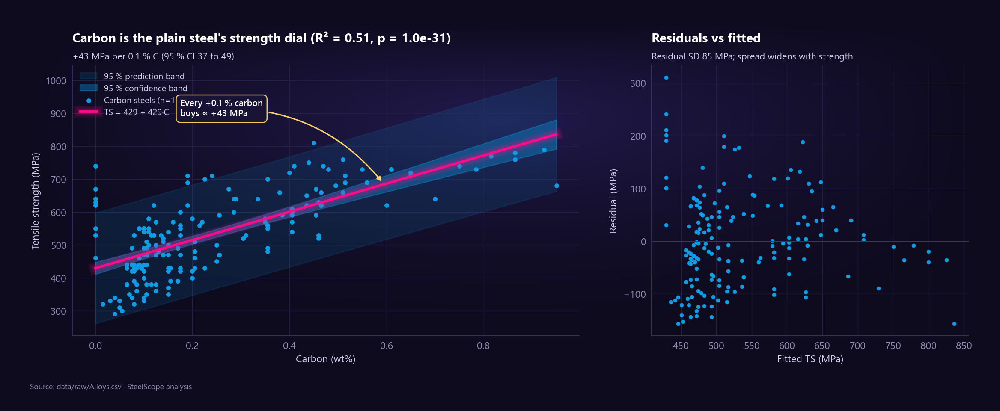</a><br><b>03_16 · Simple regression.</b> Carbon steels (n = 196): TS = 429 + 429·C, R² = 0.51, with 95 % confidence and prediction bands.</td>
</tr>
<tr>
<td valign="top"><a href="reports/figures/03_17_multiple_regression.png">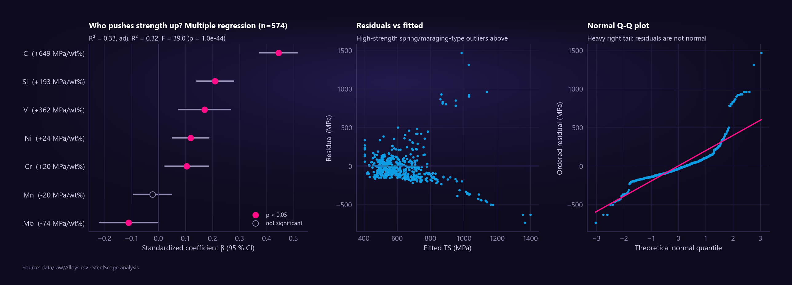</a><br><b>03_17 · Multiple regression.</b> n = 574: C, Si, V, Ni, Cr push strength up; Mn not significant; R² = 0.33 with a heavy right tail.</td>
<td valign="top"><a href="reports/figures/03_18_hexbin_ce_strength.png">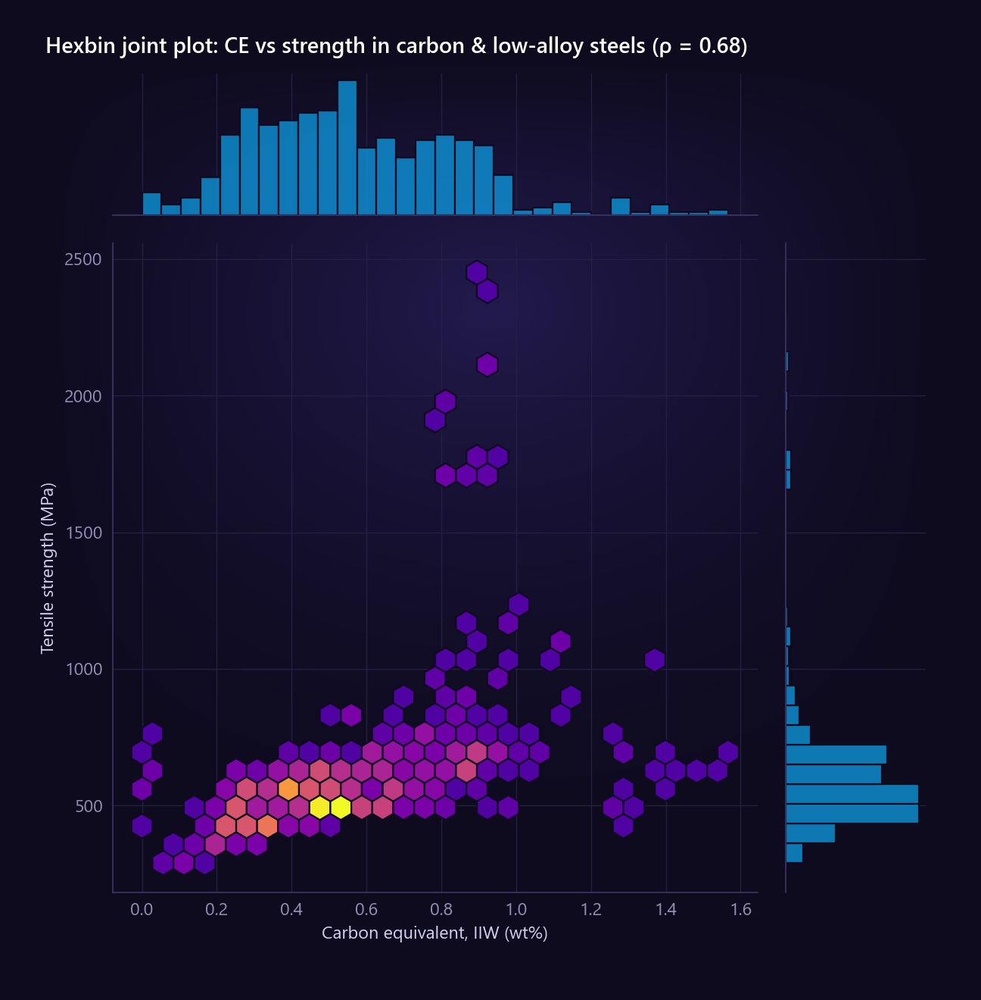</a><br><b>03_18 · Hexbin joint plot.</b> Carbon equivalent vs strength in carbon & low-alloy steels.</td>
</tr>
<tr>
<td valign="top"><a href="reports/figures/03_19_pairplot.png">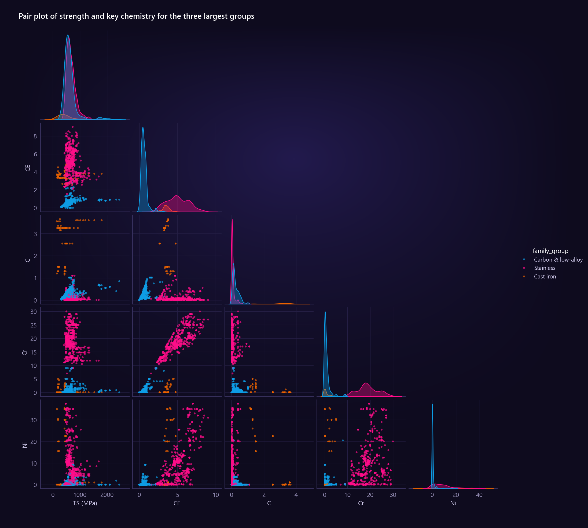</a><br><b>03_19 · Pair plot.</b> Strength and key chemistry for the three largest groups.</td>
<td valign="top"></td>
</tr>
</table>

#### Act V · The chemistry map

<table>
<tr>
<td width="50%" valign="top"><a href="reports/figures/03_20_pca_scree_loadings.png">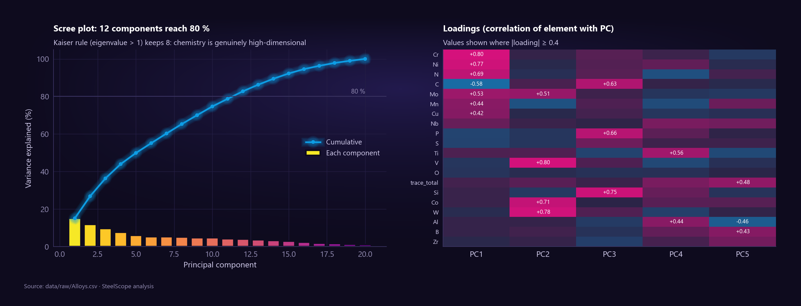</a><br><b>03_20 · PCA scree + loadings.</b> PC1 15.0 %, PC2 11.8 %; 12 components needed for 80 %: chemistry is high-dimensional.</td>
<td width="50%" valign="top"><a href="reports/figures/03_21_pca_biplot.png"></a><br><b>03_21 · PCA biplot.</b> Three arms: stainless (Cr, Ni, N), tool steels (V, W, Co), cast iron (C). Plain steels huddle at the centre.</td>
</tr>
<tr>
<td valign="top"><a href="reports/figures/03_22_circular_columns_elements.png">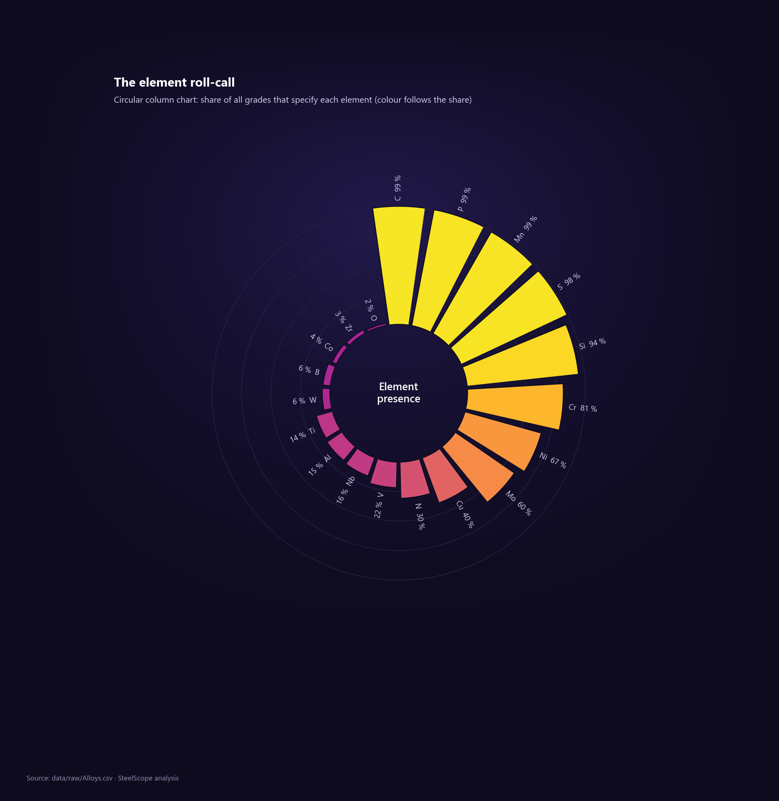</a><br><b>03_22 · Element roll-call.</b> C, Mn, Si, P and S appear in nearly every grade; W, Co, B and Zr are rare specialists.</td>
<td valign="top"></td>
</tr>
</table>

#### Act VI · Portraits

<table>
<tr>
<td width="50%" valign="top"><a href="reports/figures/03_23_radar_family_composition.png">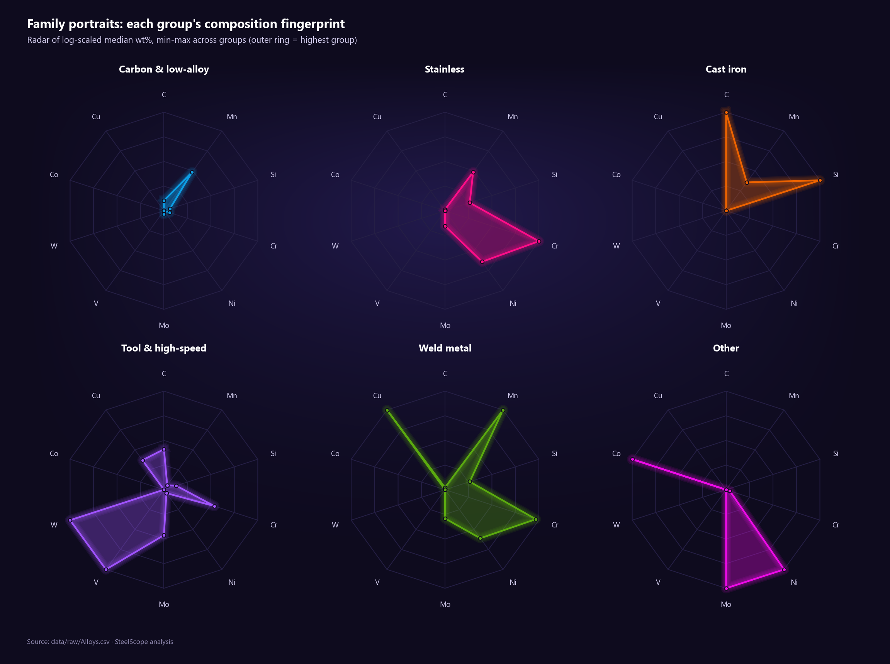</a><br><b>03_23 · Family radars.</b> Each group's median composition as a shape: tool steels peak at W and V, stainless at Cr and Ni, cast iron at C and Si.</td>
<td width="50%" valign="top"><a href="reports/figures/03_24_radar_showcase_alloys.png">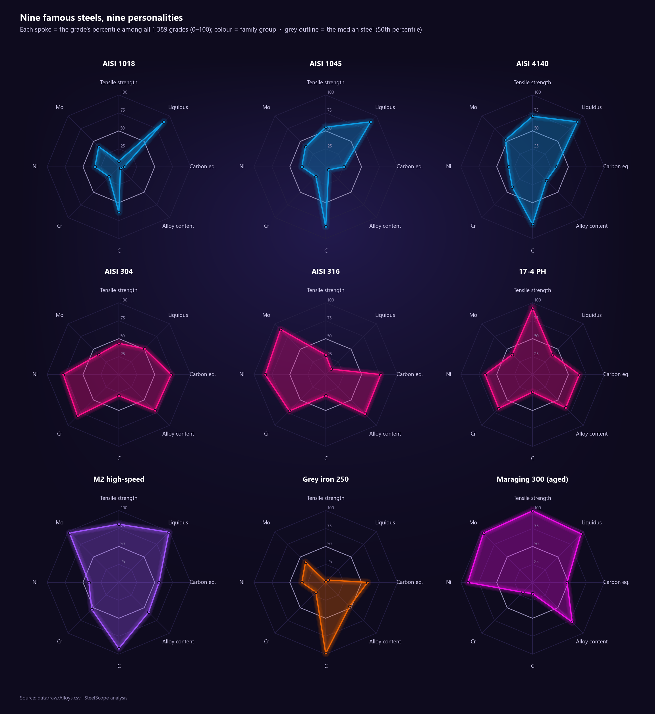</a><br><b>03_24 · Nine famous steels.</b> Percentile profiles of AISI 1018, 1045, 4140, 304, 316, 17-4 PH, M2, grey iron 250 and maraging 300.</td>
</tr>
<tr>
<td valign="top"><a href="reports/figures/03_25_radar_overlay_stainless.png"></a><br><b>03_25 · Three stainless siblings.</b> 316 reaches out on Mo (corrosion); 17-4 PH, with less nickel, beats both on strength.</td>
<td valign="top"><a href="reports/figures/03_26_parallel_coordinates.png">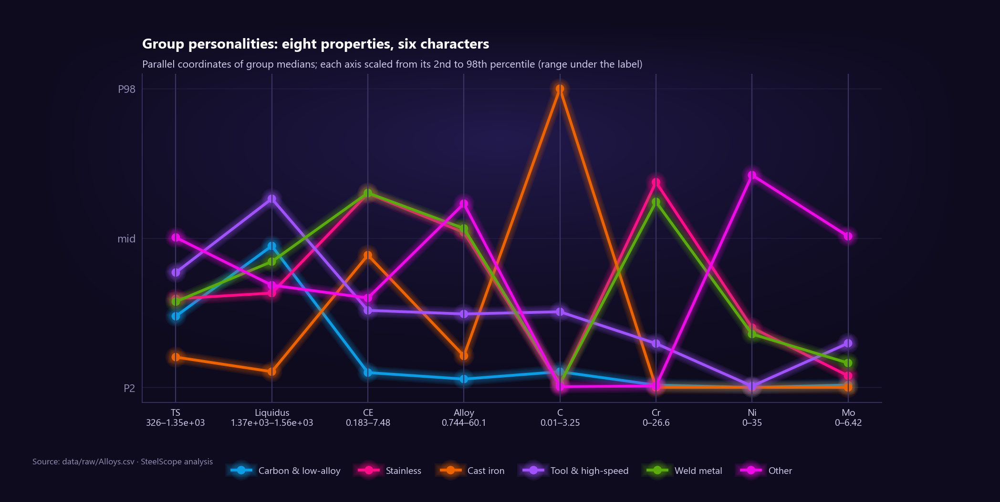</a><br><b>03_26 · Parallel coordinates.</b> Each group's medians across eight properties.</td>
</tr>
</table>

#### Act VII · The verdict

<table>
<tr>
<td width="50%" valign="top"><a href="reports/figures/03_27_waterfall_ce_4140.png">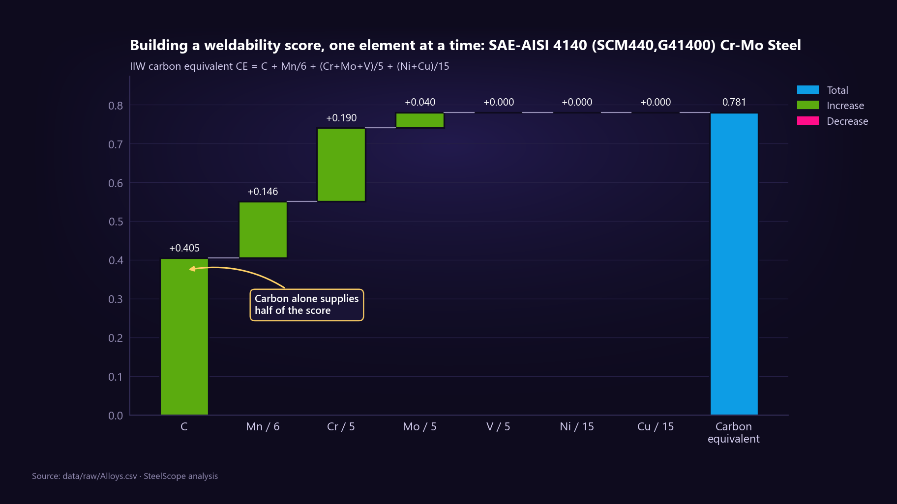</a><br><b>03_27 · Weldability, term by term.</b> AISI 4140: C 0.405 + Mn/6 0.146 + Cr/5 0.190 + Mo/5 0.040 = CE 0.781, above 0.60, so welders must preheat.</td>
<td width="50%" valign="top"></td>
</tr>
</table>

---

## 8. Technique coverage

Every course technique, where Python shows it, and where the Tableau and KNIME guides rebuild it.

| Technique | Python figure | Tableau sheet | KNIME node |
|---|---|---|---|
| Five-number summary, descriptive statistics | 03_05, 03_06 | 2, 3 | 7, 8 |
| Box / violin / ridgeline / ECDF | 02 Q1, 03_07–03_09 | 2 | 9 |
| Histogram | 03_06 | 4 | 10 |
| Outlier detection (Tukey) | 03_05 | 2 | 11 |
| Equal-width vs equal-frequency binning | 03_11 | 5 | 12, 13 |
| Domain (metallurgical) binning | 03_12 | 6 | 14, 15 |
| Chi-square test, residuals, Cramér's V | 03_13, 03_14 | 9, 10 | 16–18 |
| Correlation | 02 Q2, 03_15 | 8 | 19 |
| Simple and multiple regression | 03_16, 03_17 | 11 | 20–22 |
| Scatter, hexbin, pair plot | 02 Q5, 03_18, 03_19 | 7 | 21, 26b |
| PCA | 03_20, 03_21 | 12 | 23–26 |
| Chord (circular migration) | 03_02 | 13 | 35 |
| Ring / donut, sunburst | 03_03 | 14 | 30, 31 |
| Treemap | 03_04 | 15 | 33 |
| Circular columns (radial bars) | 03_10, 03_22 | 16 | 32 |
| Radar charts | 03_23–03_25 | 17 | 34 |
| Waterfall | 03_01, 03_27 | 18 | 36 |
| Parallel coordinates | 03_26 | – | 37 |
| **k-means clustering** | – (KNIME only) | – | 27–29 |
| **Decision tree, k-NN, random forest** | – (KNIME only) | – | 38–41 |

---

## 9. Faculty demo script

A 10-minute walk-through using only this README (or the notebooks):

| Min | Show | Say |
|---|---|---|
| 0–1 | [§1 Goal](#1-goal), [§2 Workflow](#2-workflow) | What the data is, the three questions, which tool does what |
| 1–3 | 03_01, 01 twin listings, 02 Q7 | "The dataset had a secret": 2,672 rows were 1,389 steels; fake values would have pushed the strong class from 51 % to 61 % |
| 3–4 | 03_03, 03_04, 03_05 | Who is in the data; the typical steel is 610 MPa; why medians |
| 4–5 | 03_07, 03_10 | Each family has its own strength signature |
| 5–6 | 03_13, 03_14 | The patterns are statistically real |
| 6–8 | 02 Q2 paradox, 03_16, 02 Q3 Cr–Ni map | What drives strength: carbon in plain steels, microstructure in stainless |
| 8–9 | 03_21, 03_25 | The chemistry map; more alloy is not more strength |
| 9–10 | [§6 Findings](#6-key-findings), [§14 Roadmap](#14-roadmap-and-future-work) | Takeaways; Tableau and KNIME (with ML) come next |

---

## 10. FAQ

<details>
<summary><b>Why did you throw away the 652.48 MPa values?</b></summary>

That exact value appears 469 times and equals the column average to six decimals: it was filled in, not measured.
For 459 of those rows, the same steel's twin listing holds the real measured value, and twins never disagree when
both are measured. So we use the real value and drop the fake one.
</details>

<details>
<summary><b>Why medians instead of averages?</b></summary>

Every variable is right-skewed: a few grades are extremely strong or extremely alloyed. The mean strength
(651.6 MPa) sits above the median (610 MPa), pulled up by the heavyweights. The median describes the typical steel.
</details>

<details>
<summary><b>Why is the 1460 °C melting point "fake"?</b></summary>

It is not wrong, but it is not a measurement. Physics says the liquidus drops as carbon rises; these values do not
move with carbon, they appear only in plain steels, and never in cast irons or high-speed steels. It is a typical
value the source assigned per family. We keep it and flag it.
</details>

<details>
<summary><b>Where is the machine learning?</b></summary>

In KNIME, by design: k-means clustering, a decision tree and k-NN for the strength class, and a random forest for
tensile strength. The notebook exports a fair train/test split for it. See [knime/KNIME_GUIDE.md](knime/KNIME_GUIDE.md).
</details>

<details>
<summary><b>Why can't a model predict strength perfectly from chemistry?</b></summary>

Because 28 groups of grades have identical chemistry but different strength: they differ by heat treatment, which
the data does not record. On those grades even a perfect chemistry model is off by about 111 MPa.
</details>

<details>
<summary><b>Are the numbers in this README trustworthy?</b></summary>

Every number was printed by the notebook code. The notebooks rerun from scratch with *Restart & Run All* and
reproduce the same files.
</details>

---

## 11. Glossary

| Term | Plain meaning |
|---|---|
| **Tensile strength (TS)** | The pulling stress (MPa) a steel survives before breaking. Higher = stronger |
| **Liquidus** | The temperature (°C) at which the steel is completely molten |
| **wt%** | Weight percent: the share of the steel's mass that is a given element |
| **Family / family group** | Steel type (stainless, tool, cast iron…), from the grade name; 17 families in 6 groups |
| **Canonical grade** | One steel after merging its two listings (spaced and hyphenated name) |
| **Imputed value** | A filled-in placeholder, not a measurement (here: 652.48 MPa) |
| **Carbon equivalent (CE)** | Weldability index C + Mn/6 + (Cr+Mo+V)/5 + (Ni+Cu)/15; above 0.60 = hard to weld |
| **Five-number summary** | Min, Q1, median, Q3, max: the skeleton of a box plot |
| **Tukey outlier** | A value beyond 1.5 × IQR from the box |
| **Chi-square test** | Tests whether two categories are related or independent |
| **Cramér's V** | Strength of that relation, 0 (none) to 1 (perfect) |
| **Spearman ρ** | Rank correlation, −1 to 1; robust to skew and outliers |
| **Simpson's paradox** | A trend that disappears or reverses when groups are pooled |
| **PCA** | Compresses many variables into a few axes that keep the most variation |
| **Austenitic / PH stainless** | Stainless types; PH = precipitation-hardened, strengthened by heat treatment |

---

## 12. Working on this repo

- **Run notebooks in order** (01 → 02 → 03). 02 and 03 read what 01 writes.
- **Never edit generated files by hand:** `data/processed/`, `reports/`, `tableau/data/`, `knime/data/`. Change the notebook, rerun it.
- **Adding a chart:** write a `plot_…` function in the cell just above where you use it, call
  `show(plot_…(...), "03_28_name")`, and add a markdown takeaway built only from numbers the code printed.
- **Keep the theme:** use the palette names from the theme cell (`SKY`, `PINK`, `FLAME`, …) instead of new colours;
  it is validated for colour-blind readers.
- **Branches:** work on a feature branch, never commit directly to `main`.
- **Log decisions** in [docs/PROJECT_JOURNEY.md](docs/PROJECT_JOURNEY.md).

---

## 13. Run it yourself

```bash
pip install -r requirements.txt
jupyter lab
```

Open `notebooks/` and run `01_cleaning` → `02_eda` → `03_visual_analytics`, each with **Kernel → Restart & Run All**.
Figures, reports and exports are overwritten with the same results.

**The web app** (needs Node.js 20+):

```bash
cd app
npm install
python scripts/build_data.py   # only if the cleaned data changed
npm run dev                    # http://localhost:3000
```

**Tech stack:** Python 3.11+, pandas, NumPy, SciPy, scikit-learn (PCA), matplotlib, seaborn, squarify, Jupyter ·
Tableau Public / Desktop 2023+ · KNIME Analytics Platform 5.2+ · Next.js 16, React 19, shadcn/ui, Tailwind CSS 4,
Recharts (web app).

---

## 14. Roadmap and future work

**Next for this assignment**

- [x] Clean the data and document every decision
- [x] Exploratory analysis (7 questions, 8 charts)
- [x] Visual story (27 charts) and Tableau / KNIME exports
- [x] Step-by-step Tableau and KNIME guides
- [x] **Web app:** explorer, grade inspector, substitute finder, target designer ([app/README.md](app/README.md))
- [ ] **Tableau:** 18 sheets, 3 dashboards and a Story ([guide](tableau/TABLEAU_GUIDE.md)); publish to Tableau Public
- [ ] **KNIME:** the statistics workflow plus k-means, decision tree, k-NN and random forest ([guide](knime/KNIME_GUIDE.md))
- [ ] **DOCX report** combining the notebooks, dashboards and KNIME results

**Possible future work**

| Idea | Why it matters |
|---|---|
| Add processing data (heat treatment, tempering, thickness) | Explains the ~111 MPa gap between grades with identical chemistry |
| Measured liquidus values | Replaces the 1460 °C placeholders, enabling per-grade melting analysis |
| Substitute finder | Turn the k-NN on chemistry into a "find me a cheaper equivalent" tool |
| Cost and CO₂ layer | Element prices and emissions per kg to find the cheapest or greenest grade for a strength target |
| More properties | Yield strength, hardness, elongation and corrosion resistance for a full property map |
| Bigger or newer datasets | Check whether the findings hold across more standards and grades |

---

<div align="center">

*Every number in this README was printed by the notebook code. Data: `data/raw/Alloys.csv`.*

</div>
