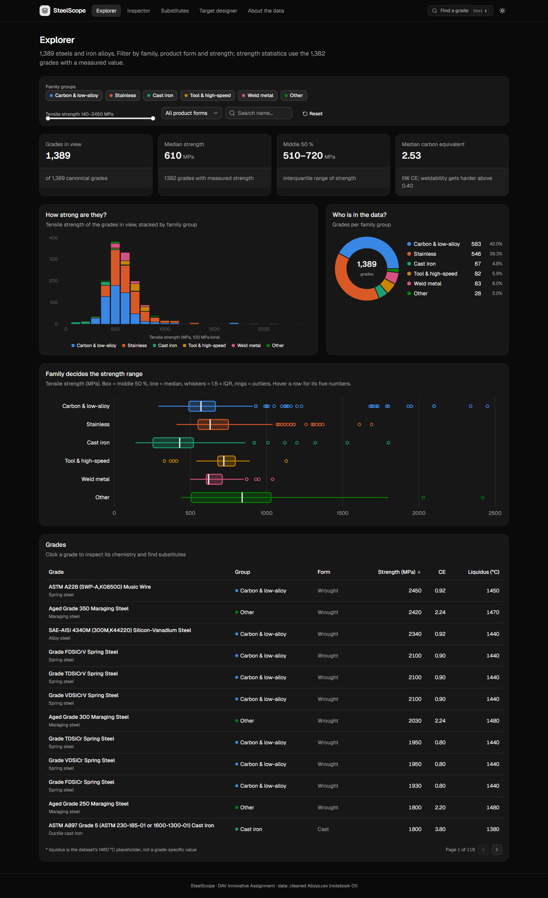

# SteelScope app

A small web application on the cleaned steel dataset: the brief's *Application Development* part. Where the
notebooks tell the story once, the app lets anyone ask their own questions of the same 1,389 grades: filter them,
open any grade, find look-alikes and search for a grade that meets a requirement.


## What we built, page by page

### 1 · Explorer: the whole dataset at a glance (`/`)

**What it does.** Filter the grades by family group, product form, a strength window and a name search. Four stat
cards (grades in view, median strength, the middle 50 %, median carbon equivalent), a strength histogram stacked by
family, a donut of who is in the data, box plots of strength per family, and a sortable table that links to every
grade. Everything recomputes as you filter.

**Why it is useful.** It answers "what is in this data and how strong is it?" in one screen. With every family on,
the median is 610 MPa and the middle half sits between 510 and 720 MPa; switch a family off and you see at once how
much each one shifts the picture. The box plots make the project's first finding visible: **family decides the
strength range**, from cast iron at the bottom to the maraging and Fe-Ni alloys at the top.

### 2 · Grade inspector: one grade in context (`/grades/[id]`)


**What it does.** For any grade: its key numbers, where it ranks inside its own family and among all grades
(percentile bars), a radar of its chemistry against its family's median, every element it contains, a waterfall that
shows how its carbon equivalent (CE) adds up term by term with the 0.40 / 0.60 weldability lines, and its five
closest grades.

**Why it is useful.** A strength number on its own means little. The inspector puts it in context. For
SAE-AISI 4140 the page shows 690 MPa, stronger than 84 % of alloy steels, and a CE of 0.78, which the waterfall
explains (carbon, then chromium and manganese) and flags as *difficult to weld*. That is the kind of judgement an
engineer makes before choosing a steel, done in seconds.

### 3 · Substitute finder: grades with the closest chemistry (`/substitutes/[id]`)


**What it does.** Pick any grade and get the ten grades whose chemistry is nearest, measured in the same 20-element
space as the PCA map (log-transformed and standardised). Each row shows the distance, how close that is compared with
every pair of grades in the data, the strength and the strength difference. The chemistry map rings the ten matches;
click any point to search from it.

**Why it is useful.** Substitution is a real problem: a grade is out of stock, or the drawing names a foreign
standard. For 4140, the finder returns 4142, 4145, 4137, 4147 and 4150 first, the same Cr-Mo family under the same
standard, which shows the method works. It also returns the European equivalents (EN 1.7220 / 34CrMo4). The strength
column and the warning box keep it honest: identical chemistry can still differ in strength because of heat
treatment.

### 4 · Target designer: from a requirement to candidate grades (`/designer`)


**What it does.** Set the tensile strength you need and the liquidus range your process can handle, optionally a
product form. The page shows how many grades qualify, which families deliver them, a strength × liquidus scatter with
your target box, and the full candidate list. A switch leaves out the 524 grades whose liquidus is only the 1460 °C
placeholder.

**Why it is useful.** It turns the data around: instead of "what is this grade?", it answers "which grade do I
need?". With the default target (800–1200 MPa, 1400–1500 °C), 94 grades qualify and 68 of them are stainless.
Change one slider and you see the trade-off immediately.

### 5 · About the data (`/about`)

The cleaning log step by step (2,672 raw rows → 1,389 grades), the six family groups, the methods (strength classes,
CE formula, PCA loadings, distance, percentiles) and the limits a user should know. Every number on it is read from
the data files.

### Dark mode

Every page has a light and a dark theme (toggle in the header; it follows the system setting by default).



## Why an app on top of the notebooks?

| Notebooks / Tableau / KNIME | This app |
|---|---|
| Show the findings we chose to present | Lets the user ask their own question |
| One chart per idea, fixed | Every chart recomputes for the filters you set |
| Need Python, Tableau or KNIME installed | Opens in any browser, on a phone too |
| Analysts read them | Engineers and buyers can use it directly |

There is no prediction in the app on purpose: the project keeps all machine learning in KNIME. Every number shown is
computed from the cleaned data, by the data script or in the page.

## Run it locally

```bash
cd app
npm install
npm run dev
```

Open http://localhost:3000. Press **Ctrl K** (or the *Find a grade* button) anywhere to jump to a grade.

```bash
npm run build && npm start   # production build: 2,787 prerendered pages
npx vitest run               # unit tests for the statistics helpers
```

## Deploy on Vercel

The app lives in the `app/` folder of the repository, so Vercel must be told to build from there.

1. Push the repository to GitHub (`git push origin main`).
2. Go to [vercel.com/new](https://vercel.com/new), sign in with GitHub and **Import** the `DAV-Assignment`
   repository.
3. In **Configure Project**:
   - **Root Directory** → click *Edit* and choose **`app`** (this is the important step);
   - **Framework Preset** → *Next.js* (detected automatically);
   - Build command, output directory and install command → leave the defaults;
   - Environment variables → none needed.
4. Click **Deploy**. The first build takes about a minute and prerenders every page.
5. Open the `*.vercel.app` link Vercel gives you. Every later `git push` to `main` redeploys automatically;
   pushes to other branches get their own preview link.

The data JSON files are committed, so Vercel does not need Python. If the cleaned data changes, rerun
`python scripts/build_data.py`, commit the new files and push.

## Data

The app reads files written by `scripts/build_data.py` from `../data/processed/steels_clean.csv` (the output of
`notebooks/01_cleaning.ipynb`):

| File | Contents | Used by |
|---|---|---|
| `src/data/grades.json` | One record per grade: names, family, group, form, strength, class, liquidus, composition, CE, PCA coordinates, ten nearest neighbours | Server only (pages send the browser just the fields they need) |
| `src/data/meta.json` | Element lists, PCA summary and loadings, strength classes, cleaning log | Server only |
| `public/data/search.json` | `[id, name, group]` per grade | Grade search, fetched once |
| `public/data/points.json` | `[id, PC1, PC2]` per grade | Chemistry map, fetched once |

The PCA and the neighbour search use the same composition space as notebook 03 (20 features, `log1p`, z-score);
the script reproduces the notebook's explained variance (PC1 15.0 %, PC2 11.8 %).

## Stack and structure

Next.js 16 (App Router, Cache Components), React 19, TypeScript, Tailwind CSS 4, shadcn/ui (Base UI primitives),
Recharts, Lucide icons, Vitest.

```
app/
├── scripts/build_data.py        ← data preparation (Python, pandas, scikit-learn)
├── public/data/                 ← search index and map points for the browser
├── docs/screenshots/            ← the images in this README
└── src/
    ├── app/                     ← pages: explorer, grades/[id], substitutes/[id], designer, about
    ├── components/              ← page sections and charts (components/ui = shadcn)
    ├── hooks/use-theme.ts       ← light / dark toggle
    ├── data/                    ← grades.json, meta.json (server only)
    └── lib/                     ← data access (server), statistics helpers, steel domain rules, types
```

Family-group colours come from a palette checked for colour-blind separation in light and dark mode; scatter plots
also use a shape per group, and every chart has a legend, labels or a table beside it.
